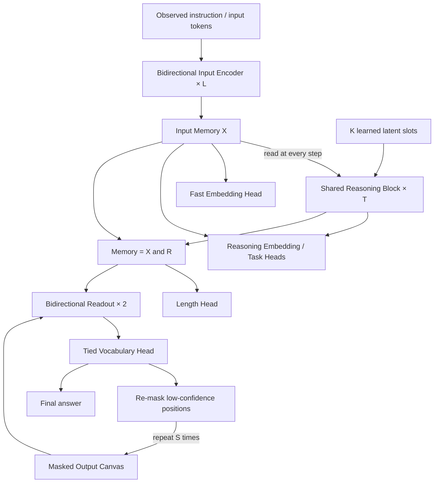

# Nuri v0 Architecture

Status: design spec with an executable implementation. Fixed-shape A100/H100 throughput is measured in [GPU_COMPARISON.md](GPU_COMPARISON.md). The first Dense Base completed training, but direct evaluation found inadequate generation and an all-MASK canvas symmetry defect; see [DENSE_BASE_EVALUATION.md](DENSE_BASE_EVALUATION.md). D-019 corrects the position path. Corrected language quality remains unmeasured.

> **User decisions in §14 take priority.** If the body and §14 disagree, follow §14 and record the conflict in §17 (open questions).

## 1. Goals and scope

One bidirectional encoder-based model supports embeddings, retrieval, classification and instruction-conditioned text generation. It combines the latent recurrent reasoning of `.dev/idea1.md`, the bidirectional generation of `idea2.md`, the sparse MoE of `idea3.md` and the modern encoder block of `idea4.md`.

Hardware is one A100 80GB or H100. The training time is **about one day for all released models together** (D-003, D-006). Languages are Korean and English first, with some Japanese (D-002). The outputs are dense/MoE × base/IT (four models), an embedding model and the tokenizer, all released under MIT (§15). Tokenizer details and the data mix are not decided yet.

The ~49.3M dense model is a reference for checking the structure and the cost math. No separate pilot is run (D-014); public training follows the release settings in §3 and the shared budget in §11. We do not assume that one day of training from scratch produces general chat quality. Reusing a pretrained encoder is a separate comparison path.

Here "encoder family" means every self-attention is non-causal and there is no autoregressive decoder. Because there is a separate cross-attention readout, the topology is not a strict single BERT stack. The precise description is **bidirectional encoder backbone + recurrent latent core + bidirectional masked readout**. A simpler baseline that processes the prompt and the masked output in one encoder stack is part of the future comparisons.

## 2. Overall structure



`T_reason` is the number of latent state updates and `S_refine` is the number of output refinement rounds. They are separate compute axes; both default to 4. By default, `X` and the final `R` are not recomputed during generation. The optional draft feedback experiment recomputes R for each round, as described in §9; it remains OFF.

## 3. Reference sizes

| Item | v0 value | Notes |
|---|---:|---|
| hidden dimension `D` | 512 | scratch reference architecture |
| attention heads `H` | 8 | MHA, head dimension 64 |
| SwiGLU intermediate `F` | 1,408 | two gated projections + one down projection |
| input layers `L` | 6 | separate weights |
| reasoning blocks | 1 | the whole block is shared across T steps |
| reasoning slots `K` | 16 | each slot has its own learned initial value |
| training depth `T` | 4 | starts with a fixed depth |
| readout layers `J` | 2 | separate weights, shared across S rounds |
| output refinement rounds `S` | 4 | 8 is also compared in evaluation |
| reference vocabulary `V` | 32,768 | changes with the tokenizer choice |
| first input limit `N` | 512 | longer inputs are a separate experiment |
| first response limit `M` | 64 | includes EOS; the share of longer data is recorded |
| embedding dimension | 256 | fast / reasoning modes |
| precision | BF16 candidate | check real GPU and backend support |

The 32,768 vocabulary does not mean a tokenizer was chosen. It is decided after checking the Korean/English mix and whether an existing checkpoint is reused. When a pretrained model is reused, its vocabulary, hidden size, norm, FFN and position scheme are kept, and the parameter counts in this table do not apply.

### Release model sizes (D-009)

The table above is the structure-check reference (49.3M). The public models use the same topology at the larger settings below. Names and formulas are the same as above.

| Item | reference | **release dense** | **release MoE** |
|---|---:|---:|---:|
| `D` / heads | 512 / 8 | 768 / 12 | 768 / 12 |
| `F` | 1,408 | 2,048 | dense layers 2,048 / MoE layers 16 experts × 512, top-3 + 1 shared |
| input layers `L` | 6 | 10 | 10 (even layers are MoE) |
| readout layers `J` | 2 | 2 | 2 (layer 2 is MoE) |
| slots `K` | 16 | 32 | 32 |
| `V` | 32,768 | 65,536 | 65,536 |
| `N` / `M` | 512 / 64 | 1,024 / 256 | 1,024 / 256 |
| total parameters | 49.3M | ≈ 150M | ≈ 242M |
| active parameters | same | same | ≈ 150M |

Release dense breakdown: embedding 50.3M + input 10 × 7.08M + core 9.44M + readout 2 × 9.44M + embedding head 0.79M.

- **V = 65,536** (decided, D-016): on held-out text, 64k needs about 9-10% fewer tokens than 32k for Korean and Japanese and about 2.5% fewer for English (48k: about 5.6-5.9% and 1.7%). The cost is a 50M instead of 25M tied embedding and an estimated ~4% more training compute per byte of text from the larger vocabulary head. Korean is the primary language, so the difference counts as not small (D-012).
- **K = 32**: the core costs `T·K` slots per sample, small compared to the whole model (§10). The public models get generous slot capacity.
- **M = 256**: 64 tokens are too few for general instruction answers. The length head classes grow to `1..256` as well. IT answers longer than 256 are counted and left out of training.
- **Size and time rule**: D-017 supersedes the original D-009 eight-hour shrink rule. Keep the dense release size, start with 9 hours for dense and 7 for MoE, and use the first real-data hour to project valid processed input/output tokens. If dense projects below 3B, move time from the MoE base while preserving the shared day and all five stages (§11). Report any remaining feasibility shortfall instead of extending the day or silently changing size. Earlier draft MFU estimates do not set the budget. Processed input/output tokens and loss-bearing masked tokens are measured separately.

## 4. Input encoder and memory

The input is `tokens [B,N]` with the padding mask `valid [B,N]`. Instructions, observed context and earlier turns can go into the input. The full gold answer that is being generated must never go into the input memory.

Each input block is:

```text
h → RMSNorm → Q/K/V → RoPE(Q,K) → Bidirectional MHA → residual
  → RMSNorm → SwiGLU → residual
```

Linear projections have no bias. After a final RMSNorm we get `X = E_phi(tokens) [B,N,D]`. In v0 every input attention layer is global, to keep comparison and implementation simple.

For long-input experiments a bidirectional local/global mix is added. For example, `G-L-L-G-L-G` over 6 layers is a candidate schedule for Nuri. The last global layer tests whether it helps to merge information before pooling and memory reading. The local window is defined as `abs(i-j) <= 64`, i.e. at most 129 keys for an interior position, instead of the ambiguous `window=128`. No speedup is assumed at length 512. It is implemented as `attention_schedule` (one `G`/`L` per input layer, empty = all global) and `local_radius`; it uses a dense mask, so it changes what tokens see but is not faster, and every position may always attend to itself so long padding never produces an empty attention row. [ModernBERT](https://arxiv.org/abs/2412.13663) is prior work that combines RoPE, GLU, local/global attention and unpadding; its global cadence is separate from Nuri's candidate schedule.

Read-only `X` means its values do not change during reasoning and output refinement. **It does not mean `detach()` or a frozen encoder.** Training is end-to-end by default, and gradients from every recurrent step reach the encoder.

### Encoder strengths and the remaining gaps

Keep useful encoder properties and train the missing capabilities explicitly. These are choices to evaluate, not evidence that Nuri already matches the cited models.

| Prior work or limitation | Nuri's response | What still needs evidence |
|---|---|---|
| [BERT](https://arxiv.org/abs/1810.04805): bidirectional context for understanding | Keep non-causal input attention and shared representations for MLM, classification and embeddings | General language quality after actual training |
| [RoBERTa](https://arxiv.org/abs/1907.11692): the training recipe and dynamic masking matter | Draw fresh MLM corruption each batch and measure held-out encoder loss | One day from scratch is not the cited pretraining scale |
| [ModernBERT](https://arxiv.org/abs/2412.13663): modern positions, gated FFNs and local/global attention | Use RoPE and SwiGLU, with optional local/global layers and isolated document packing | Dense masks do not provide sparse kernels or unpadding; measure real time and peak memory |
| MLM alone does not train sentence similarity | Train fast/reasoning embeddings with positive pairs, valid negatives and Matryoshka prefixes | Same-mode retrieval and each prefix need evaluation; paraphrase pairs are not a query-document benchmark |
| MLM alone does not train the core or generator | Base training also reconstructs separated spans; IT trains answers and natural lengths | Predicted-length, EOS and refinement errors remain distinct bottlenecks |
| Repeated output refinement increases latency | Reuse fixed X/R and per-layer K/V; project vocabulary logits only where needed | Canvas attention still runs each round; generation does not stream tokens and M remains a hard limit |

[DeBERTa](https://arxiv.org/abs/2006.03654) motivates a future content/position attention comparison. It does not justify replacing the agreed RoPE geometry or claiming checkpoint reuse. Native GQA below changes execution without changing that geometry or the release defaults.

## 5. Recurrent latent reasoning core

The initial state is `R0 = learned_slots [K,D]`, expanded over the batch to `[B,K,D]`. An optional mode/task embedding can be added; it is OFF in v0.

The K/V projection of the normalized `X` is computed once per forward.

```text
K_X = W_k X, V_X = W_v X

A_t     = R_t + g_cross * CrossAttention(RMSNorm(R_t), K_X, V_X)
B_t     = A_t + g_self  * SelfAttention(RMSNorm(A_t))
R_(t+1) = B_t + g_ffn   * SwiGLU(RMSNorm(B_t))
```

Attention in these formulas includes the output projection. Cross-attention excludes input padding; latent self-attention is fully bidirectional between all slots. Shapes:

| tensor | shape |
|---|---|
| latent query | `[B,H,K,64]` |
| input key/value | `[B,H,N,64]` |
| cross-attention scores | `[B,H,K,N]` |
| latent self-attention scores | `[B,H,K,K]` |
| recurrent state | `[B,K,D]` |

All core weights (norms, attention, FFN and gates) are shared across all T steps. The K/V reuse keeps the gradient graph. The cache is never reused after an optimizer update or for a different input.

The three residual branches each have a shared sigmoid scalar gate whose output starts at 0.1. The raw parameter is initialized to `logit(0.1) = -2.197224577`. This is a stabilization experiment; it does not guarantee convergence or depth extrapolation. A `gate=1` comparison is kept. The raw recurrent state is passed to the next step, and only the final readout uses `R_final = RMSNorm(R_T)`.

Input tokens use RoPE, but latent slots have no position in the sentence, so slot RoPE is OFF by default. The `R→X` cross-attention also does not rotate slot indices and input positions in one coordinate system. Slots are told apart by their different learned initial values. If ordered lookup tasks show problems, a source-key position feature is a separate experiment.

Step embeddings are OFF by default. After fixed-T=4 training, T=1/2/4/8/16 are evaluated, without assuming that performance rises outside the trained range. In the reference, random-depth `{2,4,8}` training is a separate variant. The public models train with random depth `{2,4,8}`, and the inference default is T=4 (D-013). Weight sharing and latent recurrence follow [Universal Transformers](https://arxiv.org/abs/1807.03819), [Perceiver](https://arxiv.org/abs/2103.03206) and [recurrent-depth research](https://arxiv.org/abs/2502.05171); the reasoning ability of this combination is a hypothesis to test.

## 6. Embedding, retrieval and classification

We use `u = masked_mean(X)` over valid input positions and `r = mean(R_final)`.

```text
z_fast   = L2Normalize(P(u))
z_reason = L2Normalize(P(u + W_r r))
```

`P: D→256` and `W_r: D→D`. Fast mode skips the core. Reasoning mode lets you pick T. Even though both modes share P, they are not guaranteed to land in the same retrieval space. Default retrieval uses the same mode for query and document. Fast documents with reasoning queries are evaluated only after cross-mode contrastive alignment training.

The implemented optional `cross_mode_weight` adds a reasoning-query/fast-document InfoNCE component to embedding training. It reuses the already encoded views and applies the configured Matryoshka dimensions. Its default is zero. The unweighted component is reported as `cross_mode` in JSON/progress and `loss/pairs/cross_mode` in TensorBoard. Mixed-mode evaluation rows test alignment; their presence is not evidence that a model has learned it.

Classification separates a general-purpose head from a structure-check head. General classification and reranking may read `concat(u,r)`. The multi-hop structure-check head reads only `mean(R_final)`, blocking the X→head shortcut. This path restriction alone is not evidence of multi-step reasoning.

Embeddings need their own contrastive objective, with positive sentence or query/document pairs and valid negatives. Duplicates and false negatives in a batch are managed. Supervised pairs may be used first. In an unsupervised experiment following [SimCSE](https://arxiv.org/abs/2104.08821), independent dropout views are required; two identical views with the reference dropout=0 are never contrasted.

The token-level MLM head reads the tied vocabulary projection directly from X. MLM is useful for training the backbone, but it skips the reasoning core, so this loss alone is not read as training the core.

## 7. Bidirectional text generation

The readout processes the output canvas `C_s [B,L_out,D]`. The memory is the fixed `[X; R_final] [B,N+K,D]`. Each layer is:

```text
C → RMSNorm → Bidirectional Self-Attention + output RoPE → residual
  → RMSNorm → Cross-Attention to [X; R_final]             → residual
  → RMSNorm → SwiGLU                                    → residual
```

The two readout layers have different weights and are shared across refinement rounds. Block weights are not shared between the input encoder, the reasoning core and the readout. The token embedding and the output vocabulary weight are shared.

**Canvas input positions (D-019).** At each fresh readout entry, set `C_s[i] = token_embedding(canvas_s[i]) + position_embedding[i]` for valid output positions. The independently learned table has shape `[M,D]`, uses the existing normal initialization scale, and is added once before the first block. Padding gets no position vector. Q/K-only self-attention RoPE cannot break an all-MASK value symmetry: identical value vectors still give identical attention outputs. Residual positions distinguish the values and memory queries from the first fill. They do not expose answer content or change X/R caching.

New reference, release and tiny presets use `canvas_position_encoding="learned"`. A legacy configuration without this field means `"none"` and keeps its old topology and strict weight loading. An explicit repair initializer adds only this table and preserves every existing tensor. It starts a fresh optimizer, schedule and run counter; it is not exact resume. Legacy full states may resume a legacy model, but cannot resume a corrected model. Input-length-offset memory RoPE and a deeper readout remain separate experiments.

Memory cross-attention uses no RoPE by default. Canvas positions are positions inside the output and are not treated as the same coordinates as input positions. The memory K/V of X and R are projected separately per readout layer and reused for the S rounds of one generation request. Canvas hidden states and self-attention K/V are recomputed every round.

### Information access contract

| query | keys/values it may access |
|---|---|
| input encoder token | valid input tokens of the same sample |
| reasoning slot | X of the same sample, latent slots |
| output canvas position | valid positions of the current corrupted canvas, X, R |
| X / R | X never reads the output canvas; R also excludes it by default, with the explicit draft-feedback exception in §9 |

With packing, attention to other samples/documents is blocked. For answer positions that carry a loss, the gold embedding is never left in the input; it is replaced with the real MASK embedding. Answer positions that stay visible after corruption are allowed context. The current gold answer is never added as teacher memory.

### Length and EOS

`LengthHead(concat(u,r))` predicts a distribution over lengths `1..M`, EOS included. Reference M=64, release M=256. For automatic length in IT models, `L_hat = argmax` sets the canvas length. An empty answer is a single EOS, i.e. length 1. The base model's length head is never trained, so base generation takes an explicit `canvas_len`. The base objective with random span lengths never trains length prediction.

Training uses canvases of the gold length. So the gold length is indirectly given through the canvas shape, which is a train/inference gap. Default IT evaluation uses the predicted length; oracle-length results are reported separately as an upper bound for the refiner. Base models are evaluated with a user-given length, and this is stated. The share of data longer than M is recorded; such data is never silently cut into wrong targets.

An EOS in an intermediate round never stops generation early. After the last round, the answer is cut at the first EOS. Missing EOS, too-early EOS and length prediction errors are logged separately. If length errors are the main bottleneck, a fixed canvas + EOS-tail objective is compared.

### Training objective and output refinement

The first generation training is **conditional masked denoising**. We do not call it diffusion yet. With probability 10% the whole answer is masked; otherwise the mask ratio is drawn from `[0.15,0.95]`. EOS positions are corrupted too. At least one position is always masked.

```text
L_gen = sum(CE(logits_i, target_i), i in masked_positions) / masked_count
L_len = CE(length_distribution, gold_length)
```

`L_gen` is computed per sample first and then averaged over the batch. This is a different contract from a token mean that divides by the batch's total masked count. `L_len` applies only to the natural answer length labels of IT/instructions, never to random span denoising batches.

One training sample uses one corruption and one readout forward. The S=4 rounds are not unrolled into the training graph. Computing vocabulary logits only at masked positions reduces training cost. Unmasked positions are used as context and get no CE.

Inference starts with the following heuristic based on [Mask-Predict](https://aclanthology.org/D19-1633/).

1. Fill every position of the predicted length with MASK.
2. In round `s=1..S`, predict all current MASK positions in parallel.
3. Store, for each position, the probability from the last time it got a masked prediction.
4. If this is not the last round, re-mask the `ceil(L_out*(S-s)/S)` positions with the lowest stored confidence. Positions filled earlier can be re-masked too.
5. After the last fill, apply the EOS rule and return the answer.

A softmax that a visible token produced while seeing its own embedding is never used as new confidence. A fixed token keeps the confidence of its last masked prediction. The training corruption and this refinement schedule are not the same distribution, so performance is measured per refinement round. Initial sampling is greedy; stochastic sampling is a later comparison. MASK and PAD are never written into the answer.

This method is not the same algorithm as absorbing masked diffusion. A diffusion variant following [LLaDA](https://arxiv.org/abs/2502.09992) must define the forward corruption process, timestep weighting and reverse transition together. A mix of some diffusion loss and ad-hoc remasking is not treated as the same model without verification.

**Supplementary block comparison.** An optional `block_size` applies Mask-Predict to left-to-right output blocks. Earlier blocks stay fixed, future blocks stay MASK, and only the active block is filled and re-masked. Attention remains bidirectional over the full canvas and default X/R stays cached; this option rejects draft feedback. Rounds are per block, so report actual readout calls and latency. Full-canvas inference remains the default and the frozen repair gate keeps its original sampler. See [BLOCKWISE_GENERATION.md](BLOCKWISE_GENERATION.md) and the transfer limits in [LITERATURE_REVIEW.md](LITERATURE_REVIEW.md).

## 8. Training paths

### A. Scratch pilot of the new structure — v0 reference

The ~49.3M model checks the structure with backbone MLM, supervised contrastive pairs, short instruction answers and structured reasoning tasks. General language ability and the effect of reasoning are kept apart. Synthetic tasks use relation composition, bounded arithmetic, graph reachability and so on, with template/entity/graph-based splits to reduce memorization.

The candidate batch mix is text MLM 30%, embedding pairs 30%, short denoising instructions 25% and reasoning tasks 15%. These ratios are unverified starting values. Each kind is its own batch, and only objectives with valid labels are active. We never invent labels for every head on the same sample.

Many objectives update the same backbone, so per-task validation and loss/gradient sizes are logged. Losses are normalized per valid position or valid pair. The initial `L_len` weight of 0.1 is tunable; other task losses start with weight 1 inside their batch. Global task weighting is read together with the batch sampling ratios.

v0 does not use intermediate same-answer supervision, monotonic-confidence losses, forced-state-change losses or latent-diversity losses, so that a healthy fixed point is not confused with collapse.

### B. Reusing a pretrained encoder — language-quality-first path

After choosing a checkpoint whose language, license and tokenizer fit, its encoder E is kept as is and the reasoning/readout/heads are attached. Swapping its LayerNorm for RMSNorm or changing its FFN means it is no longer plain checkpoint reuse. D and V change, so parameter counts and costs are recomputed.

A short backbone freeze/warmup followed by joint training with a lower backbone learning rate can be tried. Freezing is a separate training strategy and is not part of the read-only memory definition. Having an existing encoder does not mean the new masked generator can chat.

We do not try to finish both A and B in one day. The user's goal is to validate the new structure, so A is the current baseline. Whether to prioritize B is decided again once data and checkpoints are chosen.

### C. Staged training for release (D-005, D-007, D-010)

The mixed batches of A are split into release stages. Each stage produces its own public model.

| Stage | Starts from | Batch mix | Trained parts | Output |
|---|---|---|---|---|
| Base | scratch | text MLM 50% + **text span denoising** 50% | encoder, core, readout, vocab | `nuri-base`, `nuri-base-moe` |
| IT | base | instruction denoising 70% + structured reasoning tasks 15% + text span denoising 15% (prevents forgetting) | everything + length head | `nuri-base-it`, `nuri-base-moe-it` |
| Embed | dense base | contrastive pairs (+ Matryoshka 64/128/256) | encoder, core, P, W_r | `nuri-base-embed` |

Further Base training can explicitly use `--init` with a compatible checkpoint. The loaded geometry and tokenizer take precedence over the scratch preset, and optimizer/schedule counters start fresh. `--resume` instead restores a compatible full interrupted state and takes priority over `--init`. The D-019 repair reuses learned weights through this warm-start path. The retained Dense Base already finished its learning-rate decay, so its repair warm start uses peak LR 1e-4 instead of the scratch Base peak 3e-4, with the unchanged warmup, WSD shape and 50/50 MLM/span mix (D-021). The interrupted MoE Base never decayed; its repair peak is a separate explicit stage choice.

**Grouped train/valid/test inputs (D-020).** Training uses only `train`. Assign raw document and family identities before chunking, keep exact-duplicate connected groups together, and verify split hashes privately. A retained checkpoint's former training groups stay in training; known consulted examples and their connected families go to validation. A retrospective split does not erase earlier exposure or establish a pristine test. See [DATA_SPLITS.md](DATA_SPLITS.md) for preparation and [HOLDOUT_MONITORING.md](HOLDOUT_MONITORING.md) for the private runtime schema. Input paths, sources and exposure ledgers remain in ignored storage under D-008.

**Text span denoising** is the base-stage objective that trains the readout and core from raw text alone. For a tokenized document `d`, first choose the cut `c` and the raw span length `m`, then split into `x=d[max(0,c-N):c]` and `y_raw=d[c:c+m]`. `m` is between 16 and `M` and never exceeds what is left in the document. **EOS is appended only when the span reaches the end of the document** (`y_raw + EOS`). A span that ends in the middle uses only `y_raw` as the target, without EOS. If a span that reaches the end already has M tokens, the cut `c` moves one token forward so the span still ends at the document end and EOS fits. Canvas corruption follows §7. Only the separated x is encoded. Encoding the whole document bidirectionally and then cutting the prefix of X, or reusing the X cache of an MLM batch, would leak the target. Spans and packed attention never cross sample/document boundaries.

Without this path the base model's readout would never be trained. The base generation API requires an explicit `canvas_len`; the automatic length head is enabled after IT. An infill form, with a sentinel in the middle of the input and the missing span to fill, is a later experiment.

No embedding model is made for the MoE line. If time remains, `nuri-base-moe-embed` is added.

## 9. MoE and experimental features

Turning on every feature at once makes it impossible to tell causes and effects apart. The user's ideas go in either as part of the base structure or as independent feature variants.

| Feature | Default | Where it applies / experiment contract |
|---|---|---|
| sparse MoE | reference OFF / release MoE ON | reference: input layers 3 and 6, 4 experts, top-2 candidate. release: the compute-matched setup below (D-011) |
| recurrent core MoE | OFF (implemented) | `MoEConfig.core`; shared weights route the active B×K tokens each step; `core.last_step_expert_counts` records per-step counts |
| grouped expert projections | OFF (implemented runtime option) | `MoEConfig.backend="grouped"` uses a supported grouped operation or the portable loop; benchmark reports successful measured paths; no GPU speed gain is claimed |
| QK normalization | reference OFF / **release ON** (D-013) | per head after the projection, before RoPE; RMS form and scale defined. Public models turn it on without an A/B test |
| local/global attention | OFF (implemented) | mixes input layers only, for long inputs; latent K=16 keeps full attention; `attention_schedule`, `local_radius` |
| GQA | OFF (implemented) | `num_kv_heads` divides query heads; projected/cached K/V keep reduced heads; compare quality, real time and memory |
| native GQA execution | OFF (implemented runtime option) | `set_native_gqa` / `--native-gqa` asks SDPA to consume compact heads; portable repetition is the default; support does not guarantee a fused kernel |
| latent K/V projection | OFF (implemented MLA-style bottleneck) | `kv_latent_dim`: shared down-projection then separate K/V up-projections; caches still contain expanded K/V, so this is not full latent-cache MLA |
| hypothesis slot groups | OFF (implemented) | `slot_groups` divides K; early self-attention stays within groups, the final scheduled step merges all slots; no claim of distinct learned hypotheses |
| adaptive halting | OFF (training-free variant implemented) | learned halting needs min/max T, benefit/correctness supervision, a compute penalty and calibration; the implemented `halt_tol` stops a sample at inference once one step changes its state by less than the tolerance, and `halting_curve` reports accuracy vs mean core steps |
| random reasoning depth | reference OFF / **release ON** (D-013) | sampled from `{2,4,8}` per batch |
| intermediate supervision | OFF | only, and limited, when real intermediate-state labels exist |
| draft→reasoning feedback | OFF (implemented experiment) | `draft_feedback`; each round recomputes R from X plus the corrupted draft, then rebuilds readout memory; length prediction stays draft-free |

Release QK-norm is RMS normalization over the head dimension. It is applied after the Q/K projections and before RoPE in the self-attention layers that use RoPE, and the attention scale stays `1/sqrt(head_dim)`. Q and K each have a learnable gain and epsilon=1e-6. Latent and cross-attention still get no RoPE, as contracted above; the implementation also applies QK-norm to their queries and keys. Random depth picks from `{2,4,8}` with equal probability per batch and uses full BPTT through all steps. It is separate from the inference default T=4. These settings are the user's choice D-013; any performance gain has not been tested yet.

The MoE router picks top-k per token with a softmax. The chosen expert weights are renormalized and combine the SwiGLU outputs. The first single-GPU experiments use dropless routing, so overflow tokens are never silently dropped. The router runs in FP32 (autocast disabled) and has a load-balancing auxiliary loss, a z-loss and expert token count logs; their weights are tuned from the logs. Any capacity/drop policy is recorded explicitly. [Switch Transformers](https://arxiv.org/abs/2101.03961) is the reference for sparse routing and its stabilization; Nuri's top-k setup is not the same structure.

With 4 experts of F=1408, top-2, replacing 2 input layers adds about 12.98M FFN parameters over dense. But each token then computes two chosen experts of F=1408, so its FFN compute is also about twice the dense FFN. Having more experts is never reported as "same compute as dense". Active parameters, total parameters and router/dispatch cost are recorded separately. A compute-matched MoE with narrower FFNs is a separate comparison.

**Release MoE setup (D-011).** 16 experts (F=512 each), top-3 routing and one always-on shared expert (F=512), so the active FFN width per token is 512×4 = 2,048. This matches the dense F in **FFN matmul compute**; it does not mean router, dispatch, gate and combine costs are equal too. It applies to input encoder layers 2, 4, 6, 8, 10 and readout layer 2. A single GPU has no all-to-all communication. The grouped GEMM/dispatch backend is measured after implementation, and the number of tokens processed in the same 8 hours is recorded separately.

The router applies the softmax only to the 16 routed experts and renormalizes the top-3 probabilities within the chosen set. `FFN(h)=E_shared(h)+sum(w_i*E_i(h), i in top3)`. The shared expert is excluded from top-k and from the balance/z-loss. Per-layer load is computed without padding. With `f_i=assignment_count_i/(3*n_valid_tokens)` and `P_i=mean(router_probability_i)`, the balance loss candidate is `alpha*16*sum(f_i*P_i)`. The alpha and z-loss weights are tuned from logs. Readout expert load is logged per refinement round. In a top-1 variant, a selected weight of 1 cuts the path from the task loss to the router, so the raw softmax probability gate or similar must be defined separately (the implementation rejects top-1 for now).

Halting norms are calculated in FP32, and NaN/negative tolerances are rejected. `halt_tol` cannot be combined with `return_states` or `slot_groups > 1`: stopping early would skip the required final group merge. Positive infinity remains a diagnostic one-step setting for the ungrouped core; zero runs the full scheduled depth. A small update is not proof of a correct answer.

Grouped projections are opt-in and keep the portable expert loop as the default. The current conservative support policy admits CPU FP32 and CUDA BF16 on capability 9.0 or higher; newer build-specific support requires verification on that runtime. Inputs and weights are cast explicitly and made contiguous. Recognizable unavailable-kernel errors fall back; OOM and unknown execution errors propagate. Benchmarks distinguish the requested setting, measured successful path and mixed execution, and exclude warmup history.

Draft feedback adds a learned source-type vector to draft token embeddings and lets the core read `[X; corrupted_draft]`. It restarts from the learned slots each round rather than continuing the previous R. Training supplies the same corrupted canvas used by the readout, with hidden targets replaced by MASK. Natural length prediction uses a separate draft-free R so it cannot infer gold length from the canvas. Inference first computes draft-free R for length, then reruns the core before every refinement round and rebuilds readout K/V. `halt_tol` applies to every call and generation reports the sum of actual core steps per sample. This adds up to `(S+1)*T` core updates without halting, changes the fixed-memory contract and has no measured quality benefit yet.

Draft tokens in the feedback branch get a learned canvas-position embedding (`draft_positions`), so the core can tell their order; output RoPE remains in the readout. Each round still restarts the core from the learned slots; carrying the state across rounds would need multi-round training. Training sees visible gold context from one corruption, whereas refinement sees model predictions. These gaps need controlled quality and latency comparisons before enabling feedback in a release.

GQA with 12 query heads and 4 K/V heads stores one third as many cached K/V elements as MHA at the same dimensions. Attention still computes all 12 query heads. Native execution avoids explicit repetition in Nuri, but an SDPA math backend may repeat internally. The runtime setting is checked on exact training resume; old states default to the portable path. The latent K/V bottleneck changes projection rank and weights; it does not shrink the expanded cache beyond the selected K/V head count.

### Additional experiment ideas

1. **Reasoning-conditioned Matryoshka embedding.** A contrastive loss on each of the first 64/128/256 dimensions of the 256-dim representation. It combines [Matryoshka Representation Learning](https://arxiv.org/abs/2205.13147) with the reasoning path. Vector storage becomes adjustable, but backbone compute does not shrink automatically.
2. **Branched hypothesis slots.** Split K=16 into 4 groups; early steps use group-wise latent self-attention, and the last step merges everything. Every group reads the same X. Without explicit candidate labels or a critic we do not assume the groups learn different hypotheses. Compute and quality are compared against dense K=16.
3. **Learned step selector.** Predict the expected gain of more compute from real task results at several T. High confidence alone never decides correctness or stopping. The selector's own error and time cost are included.

## 10. Parameters and compute

Below are the linear matrix and embedding counts for V=32768, D=512, F=1408. Small terms (norms, gates, length/classification heads) are added separately.

| Part | Formula | Parameters |
|---|---|---:|
| shared token/vocabulary embedding | VD | 16,777,216 |
| input encoder, 6 layers | 6(4D²+3DF) | 19,267,584 |
| shared reasoning block | 8D²+3DF | 4,259,840 |
| learned latent slots | KD | 8,192 |
| readout, 2 layers | 2(8D²+3DF) | 8,519,680 |
| learned canvas position table (D-019) | MD | 32,768 |
| embedding P + reasoning W_r | 256D+D² | 393,216 |
| total, small heads excluded | | 49,258,496 |

The length head `2D→64` adds 65,536 weights. With RMSNorm and task heads the total is about 49.3M. Raising T and S does not add shared weights, but it does increase activations, compute and latency. (`tests/test_model.py` checks these counts and the release counts below exactly.)

Inference matmul FLOP estimates for one sample with N=512, K=16, M=64, T=4, S=4 follow. 1 MAC = 2 FLOPs; softmax, norms, activations, sampling and kernel overhead are excluded. The full vocabulary projection at every canvas position and the precomputed fixed-memory K/V are included.

| Part | GFLOPs |
|---|---:|
| input encoder | 22.951 |
| reasoning, including cached source K/V | 1.084 |
| generation, readout + vocabulary + memory K/V | 14.143 |
| total | 38.179 |

At the same N/M, T=8 adds about 0.547G, but S=8 adds about 13.036G. With input N=1024, output M=128 and S=8 the total is about 110.774G. So a small latent reasoning loop does not mean generation as a whole is cheap.

Training processes one corruption, so the inference S=4 formula is not simply multiplied. Real training throughput and peak memory are measured, including backward, optimizer, active loss logits, contrastive views and padding waste. Attention complexity still includes the global input `O(LN²D)`; we do not claim the whole model is linear in N.

### Release cost

Main weights excluding norms, gates, length and classification heads are **150,429,696** for dense and **242,515,968** for MoE. These include D-019's 196,608 canvas position weights; the legacy counts were 150,233,088 and 242,319,360. The length head `2D→256` adds 393,216 weights. "≈150M/242M" are rounded values. The MoE's 150M active count converts the experts chosen per token into dense terms; it is not the number of distinct weights one request uses. A long input can use every expert through different tokens.

Release inference at N1024/M256/K32/T4/S4, all-global input, 1 MAC = 2, with the same exclusions:

| Logits policy | Dense main matmul GFLOPs | Notes |
|---|---:|---|
| every round, every canvas position | 332.252 | upper bound including the full vocabulary projection |
| vocabulary projection only at current MASK positions | 293.597 | at S4, logits for 256+192+128+64 = 640 positions; the canvas blocks run on all positions |

The MoE's all-positions policy is about 332.403G including router matmuls; dispatch, softmax and gating are still excluded. These numbers are not training throughput or GPU latency.

## 11. One-day training plan

This is a tentative split for the day when data and runtime are ready. Longer preparation means less actual training time. Following D-004 to D-007, all five public models are made within one day (about 24 GPU-hours). The earlier split that spent 15 hours on a single dense variant conflicted with these decisions and was replaced.

| Time | Work | Output |
|---|---|---|
| 1 hour | leakage/mask/gradient checks, GPU benchmark, small overfit | backend, batch size, peak memory, throughput |
| 9 hours | dense pretraining (D-017) | `nuri-base` + intermediate checkpoints |
| 7 hours | MoE pretraining (same data order as dense; D-017) | `nuri-base-moe` + intermediate checkpoints |
| 1.5 hours | dense instruction tuning | `nuri-base-it` |
| 1.5 hours | MoE instruction tuning | `nuri-base-moe-it` |
| 1.5 hours | contrastive embedding training from the dense base | `nuri-base-embed` |
| 2.5 hours | evaluation, export, load checks before release | release packages |

The 9/7-hour base split follows D-017: at the measured A100 microbatch-64 rates the dense base gets about 3.4B processed positions and the loop MoE base about 2.2B. During the first real-data hour, compare the measured valid-token rate with the projection; if the dense base would fall below 3B, shift more hours from the MoE base. There is no room for a T=1 vs T=4 pilot in these 24 hours. It is not run separately; instead the inference T curve (T=1/2/4/8/16) of the main checkpoint is reported (D-014). That is not an independent training comparison, so it is not used as evidence that recurrence helps. Stage objectives follow §8-C.

A GPU-time-based pilot is not a fully equal-FLOP comparison. Train tokens and measured FLOPs are recorded too. A main checkpoint and a pilot with different training amounts are never compared to claim one architecture is better.

The token budget is set after measuring throughput as `processed_tokens/sec × actual training seconds`. Processed input/output tokens, masked supervised tokens, unique corpus tokens and repetition counts are kept apart. Theoretical FLOPs alone never fix how many tokens or what batch size an A100/H100 can train in a day.

PyTorch SDPA is the first backend candidate; fused backends supported on the real GPU are measured. FlashAttention, unpadding, packing, checkpointing and compile are added to fit the environment. A dense attention mask or an API name alone is never assumed to run local attention as a fast sparse kernel. The GPU runtime is decided later; training has not been tried in the current Windows workspace.

Padding on the real data (final 64k corpora, microbatch 64): 88% of documents are shorter than N=1024 (median 361 tokens), so only 44% of unpacked MLM positions, 26% of span-denoising positions and 24% of instruction positions are real tokens. `--pack-mlm` fills MLM rows to 100%. Span and instruction samples carry one canvas each and cannot be packed the same way; `--bucket` draws 8× more candidates and keeps a run of similar-length samples. The run's padded input stays within rows × N of one full batch, its padded canvas separately within rows × M (so short inputs cannot inflate canvas positions and vocabulary logits), and it has at most 4× the nominal rows (bounding the core's rows × K slots). This raises the real-token share (span 0.26 → 0.56, instruction 0.24 → 0.52) and about halves the padded positions per batch, at tens of ms of host time per span batch. Bucketed batches carry a variable number of rows; MLM retains its token-mean loss, while span/instruction batches retain their mean of per-sample losses. Actual rows/positions are logged. The selection keeps no state between calls, so resume stays exact. The D-017 first-hour check counts real (non-padding) tokens.

### Current Vast run: spending limit and measured allocation (D-018)

The user's later 48-hour discussion and current Vast authorization add a run-specific budget to the historical one-day plan above. Use one compatible on-demand A100 80 GB and spend **strictly less than USD 50 in total**. The planned rental lasts at most 44 hours and becomes shorter when the live quote requires it. Compute, container disk, transfers, startup, first-hour calibration, evaluation, retrieval and teardown all count inside the same limit and rental clock. Reserve at least USD 3 for transfer and cleanup; available account credit is not a spending limit.

Keep all five model stages and their release geometry. Measure actual mixed-task CUDA memory, iteration time, valid input/output positions, full-state save latency and production SIGTERM/resume before setting nonzero optimizer steps. The agreed starting allocation ratio is 27:5:3:1:0.75 for dense base, MoE base, dense IT, MoE IT and embedding, scaled to the remaining training time after startup, evaluation and retrieval reserves. This gives the Dense family approximately 83.7% of training time before measured adjustments. Treat the shorter MoE outputs as research checkpoints and report their training amounts; unequal training does not support a controlled Dense-versus-MoE quality comparison. Apply D-017's measured dense-token check within this shared limit; report a remaining shortfall instead of silently extending rental time or changing size. Cap embedding training at four presentation equivalents using the actual pair microbatch times accumulation. Sampling with replacement and accumulation must not be called exhaustive epochs or a larger contrastive negative pool.

Finish the five training stages and exports before bounded expensive evaluation. Full held-out coverage, inference curves and intervention checks remain required before release-quality claims. Enable TensorBoard events, progress output and timed private resume saves. A host process-group supervisor bounds training time and stalls; an independent local provider guard also bounds cost and verifies deletion of the owned instance and its container disk. Verify these controls before paid heavy work. Upload only hash-bound runtime inputs and source; keep provenance ledgers local and private.

## 12. Success criteria and ablations

The core questions are whether latent recurrence helps task performance and whether both uses survive on one backbone.

The corrected generator must pass an all-MASK position-variation check with a legacy negative control, nonzero position-table gradients, exact old-tensor preservation, padding invariance and cache equivalence. A fixed-seed symbolic CPU comparison recovered distinct four-token sequences from full MASK at S=1 and S=4 on held-out combinations, with input swaps changing the output. This is structural evidence, not natural-language quality. A paid repair must additionally improve matched real full/partial-span validation and input conditioning, and include human-read generation. Test data must not select the repair gate. Low encoder MLM loss alone never accepts the generator.

Under D-021, report a training-fitted input-free token/position-frequency baseline beside the full-mask validation gate. Freeze its sampling and smoothing before scoring, state actual training presentations and target counts, and keep it supplementary rather than changing acceptance criteria. A particular frequency baseline failing the gate does not rule out every input-free strategy. Source swaps and human-read assessment remain necessary. Clipping diagnostics refer to combined accumulated optimizer updates; sampled module gradients and position-table norms are observations, not effective Adam learning rates or proof of reasoning.

| Comparison | What it checks |
|---|---|
| independently trained T=1 vs T=4 | the contribution of recurrence; keep same-token and same-compute conditions apart |
| same checkpoint at T=1/2/4/8/16 | the effect of inference depth; mark undertrained/extrapolated ranges |
| X-only / R-only / X+R generation | each memory path's contribution to the readout |
| R=0 / shuffle R between samples | whether the core is bypassed and whether conditioning is used |
| K=1/16/32 | the effect of working-memory capacity |
| K16/T4 vs K64/T1 | core compute 1.08423G vs 1.09052G, slot weight difference 24,576; total generation cost is recomputed with the changed memory K |
| shared / unshared | parameter budget and the effect of weight sharing |
| cross-read once / cross-read every step | the effect of repeated source reading |
| fast / reasoning embedding | quality, time and embedding-space alignment |
| predicted / oracle length | separate length prediction errors from denoising errors |
| S=1/2/4/8 | the contribution and cost of output refinement |
| plain encoder / single masked-canvas encoder | baselines without a latent core |
| dense / MoE | total/active params, real time, routing stability |

On the first day, the T curve, R interventions, S curve, predicted/oracle length and fast/reasoning evaluation come first. Large ablations that need independent retraining and multiple seeds are done with a later budget. Small pilot results are read as tentative.

Retrieval uses Recall@k and MRR, classification accuracy/F1, synthetic reasoning exact match and length/difficulty generalization, and generation exact match on short tasks plus format compliance and EOS errors. Natural-language answers include human-read samples. Every result carries the data split, training examples/tokens, input/output length, T/S, parameter count, measured latency and peak memory.

### Evaluation hygiene

**Separate monitoring (D-020).** TensorBoard writes `train/<task>/objective_loss`, `valid/<task>/objective_loss` and `test/<task>/objective_loss`, plus components and assessed counts. Comparable objectives exclude MoE auxiliary penalties; existing optimized-total and routing tags remain available. Validation may run periodically and supplies repair, checkpoint and decoding choices. Test runs only at a distinct stage's completion under a frozen protocol. An interrupted repair gate preserves the full training schedule and state before final test or final-weight publication. Exact model/input/policy-bound completion receipts prevent routine repeated final assessment.

These curves use fixed bounded held-out batches, not exhaustive dataset coverage. Report the actual rows, targets, candidate counts, loss numerators/denominators and exposure caveats. Repeat fixed corruptions in eval/no-grad mode and restore training modes and random state. Final weights follow successful assessment; a different model cannot reuse the same-step receipt. Separately acquired final-test candidates need a private lineage and overlap audit before being described as untouched. Full retrieval/generation release evaluation remains separate from training-objective monitoring.

CPU sanity runs and reviews found three ways the metrics above can look good or bad for the wrong reason. `nuri/evaluation.py` handles them, and reports must state them:

- **Oracle length leaks the answer.** With the gold canvas length, a model can pick the most common answer of that length without reading the input (for example "yes" and "no" with different token counts: a tiny model scored 100% at every T, including T=0, while its predicted-length accuracy equaled the majority baseline). Oracle results therefore carry `length_only_accuracy`, and oracle exact match means something only well above it.
- **Never-seen output tokens.** A token that never appears as a training target gets only negative gradient through the tied vocabulary head, so a model trained on the synthetic tasks alone scores 0% on the disjoint-name eval split even when it can copy. Run the synthetic evaluation on checkpoints that went through the base stage, where every token is an MLM target. A further CPU run showed that even base pretraining plus 15% span mixing did not let a tiny model copy never-answered tokens, so the main reasoning split is `shared` (training name/node pools, new chains, graphs and expressions); the disjoint-name `eval` split is reported separately as a stress test.
- **Ties and degenerate batches.** Retrieval ranks break score ties by document order, so constant embeddings get recall@1 = 1/n, not 1. R interventions never use a batch of one (shuffling would be a no-op), and answers that do not fit M are excluded and counted, never cut.

Every reasoning number is reported next to its chance, majority and (for oracle length) length-only baselines.

State norm, step update norm, slot cosine/effective rank, attention entropy and expert load are diagnostics. `R_(t+1)≈R_t` alone is not called collapse, and a changing state alone does not prove reasoning. Rising answer confidence alone does not mean better accuracy.

## 13. Implementation boundaries

The implementation units are `InputEncoder`, `RecurrentReasoningCore`, `BidirectionalReadout`, the embedding/task/length heads (plus the R-only structure head), the corruption samplers, the refinement sampler, `build_ffn` (dense/MoE, with sorted expert dispatch) and the evaluation functions in `nuri/evaluation.py` (run with `scripts/evaluate.py`). The model forward and the external sampling loop are separate, and cache lifetime is limited to one forward or one generation request.

Before training we check that gradients reach the source encoder, that masked targets never stay in the input, that packing never crosses boundaries, and that padding never enters pooling or attention. Eval results with and without the cache must match. The tests in `tests/` cover these checks.

The structure is declared in [nuri_v0.design.json](../configs/nuri_v0.design.json) and the inter-agent review is recorded in [design_review.md](design_review.md). The JSON records design values; it is not a runnable trainer config.

## 14. Decision log

User decisions (D-001 to D-008, D-012 to D-014) are never changed without user approval. Claude decisions (D-009 to D-011) were delegated by the user and can be reopened in `DISCUSSION.md` with a well-founded objection.

| ID | Date | Decision | Reason | Decided by |
|---|---|---|---|---|
| D-001 | 2026-10-03 | General-purpose model: understanding, embeddings, generation | user's choice | user |
| D-002 | 2026-10-03 | Languages: Korean and English first, some Japanese | user's choice | user |
| D-003 | 2026-10-03 | One A100 80GB or H100, about one day | user's choice | user |
| D-004 | 2026-10-03 | Train and release both dense and MoE lines | user's choice | user |
| D-005 | 2026-10-03 | Release both base (pretraining only) and IT models, plus checkpoints of each stage | user's choice | user |
| D-006 | 2026-10-03 | The one-day budget is the **total** for all released models | user's choice | user |
| D-007 | 2026-10-03 | Also release an embedding model | user's choice | user |
| D-008 | 2026-10-03 | Weights and code under **MIT**. Training data sources are not disclosed and never named in tracked files (§16) | user's choice | user |
| D-009 | 2026-10-03 | Release sizes dense ≈150M / MoE ≈242M (150M active), V=65,536, K=32, M=256, with a shrink rule based on the benchmark (§3) | shared one-day budget, FLOP estimates | Claude (delegated) |
| D-010 | 2026-10-03 | Generation uses Codex v0's separated design (fixed X·R + canvas readout), and the base stage adds text span denoising (§8-C) | X·R once per request; the readout is trained in the base stage too | Claude (delegated) |
| D-011 | 2026-10-03 | Release MoE is compute-matched: 16×F512, top-3 + 1 shared (§9) | compare with dense at the same active compute | Claude (delegated) |
| D-012 | 2026-10-03 | The vocabulary size is chosen by a tokenizer experiment (32k/48k/64k, bytes per token per language) | user's choice | user |
| D-013 | 2026-10-03 | Release models turn on both QK-norm and random depth `{2,4,8}` | user's choice | user |
| D-014 | 2026-10-03 | Skip the independent T=1 vs T=4 pilot; report the inference T curve instead | user's choice | user |
| D-015 | 2026-10-03 | Keep raw/prepared datasets and downloads in ignored data/; keep the source/usage list only in .private/; reuse permitted sibling data without changing that project | user's follow-up | user |
| D-016 | 2026-10-04 | Tokenizer vocabulary 65,536 (64k) | held-out compression: ~9-10% fewer Korean/Japanese tokens than 32k for ~4% more compute per byte (estimate) | user |
| D-017 | 2026-10-04 | Keep the dense release size and give the dense base 9 hours and the MoE base 7 hours; if the first real-data hour projects the dense base below 3B processed positions, move more time from the MoE base instead of shrinking | A100 microbatch-64 calibration: 8 h dense = 3.02B, only 0.8% above the D-009 rule (docs/GPU_CAPACITY.md) | user |
| D-018 | 2026-10-04 | Current Vast run: strictly below USD 50 total, one compatible A100 80 GB, at most 44 rented hours and shorter when the live quote requires; preserve all five stages, prioritize the Dense family with starting ratio 27:5:3:1:0.75, and calibrate steps on real inputs | User selected Vast, funded credit, required careful preparation and asked for a balance of performance and experiments; agreed Dense priority, rental margin and independent teardown guards (§11) | user authorization; Codex/Claude allocation review |
| D-019 | 2026-10-05 | Add independently initialized learned canvas positions to the residual/value path in new presets; retain explicit legacy `none` loading and exact legacy resume, with a separate new-optimizer warm-start migration | Trained all-MASK symmetry, Claude/Codex agreement and conditioned symbolic learning; keep bidirectionality and fixed X/R memory | Codex/Claude correction review under the user's analysis and retraining request |
| D-020 | 2026-10-05 | Use grouped train/valid/test inputs and separate TensorBoard objective curves; use validation for selection and completion-only test with bound receipts; preserve original training exposure when repairing a retained checkpoint | User requested three splits and all three in TensorBoard; grouped private audits prevent relabeling exposed data as unseen | user instruction; Codex implementation and inter-agent review |
| D-021 | 2026-10-05 | The Dense Base repair warm start from the fully decayed retained checkpoint uses peak LR 1e-4 (scratch Base keeps 3e-4; the undecayed MoE warm start is chosen separately) and keep the 50/50 MLM/span mix; the input-free span frequency line is reported beside the repair gate but is not a gate criterion | Re-warming the decayed checkpoint to 3e-4 would put the encoder, which already works, back at the scratch peak; the frozen gate is read at peak LR against a fully decayed legacy baseline; keeping the mix makes the first repair a cleaner comparison | user approval of Claude's recommendation |

## 15. Release plan

| Repository | Stage | Contents |
|---|---|---|
| `nuri-tokenizer` | preparation | the tokenizer alone |
| `nuri-base` | Base | dense, pretraining only |
| `nuri-base-moe` | Base | MoE, pretraining only |
| `nuri-base-it` | IT | dense, instruction-tuned |
| `nuri-base-moe-it` | IT | MoE, instruction-tuned |
| `nuri-base-embed` | Embed | embedding model built from dense |

**Intermediate checkpoints** are published as revisions (branches) of the base repositories: `step-*` about every 1B tokens, and `pre-decay` right before the LR decay. The LR schedule is warmup–stable–decay (WSD), decaying over roughly the last 15%. `pre-decay` is a good starting point for continued training.

**Saving under preemption.** Training states and `model.safetensors` are written atomically (temporary file, fsync, rename), so a killed process leaves the previous complete file and never a truncated newest one. `--save-every-minutes` also writes the full state to `training_state/latest.pt` on a timer, which matters on interruptible hosts where `step-*` saves are hours apart. SIGTERM (a preempted VM, `kill`) stops training after the current optimizer step, saves `latest.pt` and exits with code 75; `scripts/run_release.py` then stops the plan, and rerunning the same plan resumes that stage from its newest state. The time a full-state save takes on the target disk must fit the provider's shutdown grace period; it is measured in the first hour.

**Package contents**
- `model.safetensors` (bf16), `config.json`, `LICENSE` (MIT)
- `modeling_nuri.py`: for HF `trust_remote_code`, wiring `AutoModel`, `AutoModelForMaskedLM` and `AutoModelForSequenceClassification`.
- Generation API `generate_refine(prompt, T=4, S=4, max_len=None, canvas_len=None)`: base requires `canvas_len`; IT uses the length head when it is omitted. `max_len` is the allowed upper bound. The bidirectional sampling loop is provided separately.
- Embedding API `encode(texts, mode="fast"|"reasoning", dim=256|128|64)`
- Tokenizer files. IT models include a `chat_template`.
- Model card: structure, parameters (total/active), training tokens, hardware and time, hyperparameters, evaluation (including T and S curves), limitations, supported languages. **Data sources are not written** (D-008).

**Saving rules**
- Full resume state (with optimizer, private) and public weights are saved separately.
- Right after saving, public weights are loaded back and checked with MLM accuracy and one generation. If that fails, they are not uploaded.

**Explicit D-019 repair initialization.** Run `tools/initialize_canvas_positions.py --source <legacy checkpoint> --out <fresh initializer folder> --receipt <ignored .private receipt> --seed 0`. The tool verifies every old tensor and dtype, strict-loads the corrected output, records source/output hashes and the seed, and refuses existing output paths. The source remains immutable; the output contains no optimizer. Start repair training with `scripts/train.py --stage base --init <fresh initializer folder>`, plus explicit private training inputs. Do not pass the legacy optimizer state as `--resume`.

## 16. Data policy (D-008)

- Tracked files (docs, configs, code, model cards, commit messages) **never contain dataset names, links or sources.** Data notes live only in the gitignored `.private/`.
- Code receives data paths through environment variables or config files inside `.private/`, and defaults never contain dataset names.
- Raw copies, normalized examples, token corpora and downloads live in the ignored `data/` directory (D-015). Source paths, names, permissions, revisions, hashes and preparation/training status remain in `.private/`. Prepared files carry only the fields used by each task.
- Import uses independent copies; it does not move, link or edit the sibling project's files. Preparation separates train/evaluation groups before chunking, deduplicates exact content within each task kind, and reports final split counts. Near-duplicates and cross-objective semantic overlap require further review. Additional acquisition details stay private too.
- Local pre-commit/commit-msg/pre-push hooks can run `tools/check_private_files.py`. They reject protected paths and known private provenance markers, including outgoing historical trees. The marker list and installed hooks stay local; ignored files are not included in model exports.
- Public documents state only the supported languages and the number of training tokens.
- The repository ships no raw or prepared data. Internal source selection and usage notes are kept in `.private/` and do not become model cards or public configuration.

## 17. Open questions

| ID | Question | Notes |
|---|---|---|
| ~~Q-12~~ | ~~vocabulary size~~ → D-012 | |
| ~~Q-13~~ | ~~QK-norm, random depth~~ → D-013 | |
| ~~Q-14~~ | ~~T pilot~~ → D-014 | |
| Q-16 | add `nuri-base-moe-embed`? | only if time remains |
| Q-17 | After the minimal position correction, do stronger span supervision, deeper readout, memory position linkage or slower/block decoding improve real conditioned generation? | Open controlled experiments; observed plateaus, gradient norms and target counts do not alone establish these causes |
