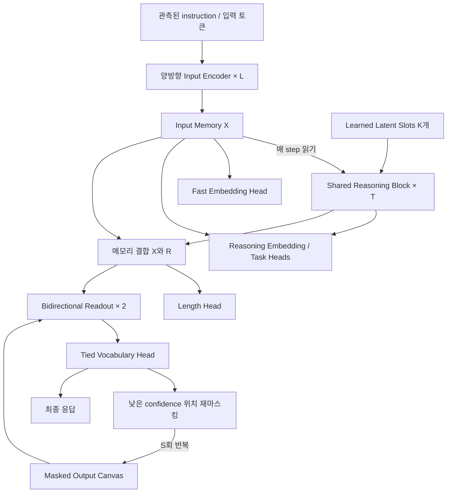

# Nuri v0 구조 설계

상태: 구현 전 설계 초안. 구조와 검증 방법을 정리했으며, 학습이나 성능 검증은 아직 수행하지 않았다.

> **사용자 확정 사항은 §14가 우선한다.** 본문과 §14가 충돌하면 §14를 따르고, 충돌 지점은 §17 열린 질문에 기록한다. (2026-10-03 Claude: 사용자 결정 D-001~D-008 반영)

## 1. 목표와 범위

하나의 양방향 인코더 기반 모델로 임베딩·검색·분류와 instruction-conditioned 자연어 생성을 지원한다. `.dev/idea1.md`의 latent recurrent reasoning, `idea2.md`의 양방향 생성, `idea3.md`의 sparse MoE, `idea4.md`의 현대적 encoder block을 연결한다.

하드웨어는 A100 80GB 또는 H100 1장, 학습 시간은 **공개할 모든 모델을 합쳐 약 하루**다 (D-003, D-006). 언어는 한국어·영어 우선, 일본어 일부다 (D-002). 산출물은 dense/MoE × base/IT 4종과 임베딩 모델, 토크나이저이며 모두 MIT로 공개한다 (§15). 토크나이저 세부와 데이터 혼합 비율은 미정이다.

약 49.3M 파라미터의 작은 dense 모델은 구조·계산 검증용 reference다. 별도 pilot은 실행하지 않으며(D-014), 공개 학습은 §3의 release 설정과 §11 합산 예산을 따른다. 하루 동안 scratch 학습으로 범용 대화 품질이 완성된다고 가정하지 않는다. 사전학습 encoder 재사용은 별도 비교 경로다.

여기서 encoder 계열이라는 뜻은 모든 self-attention이 noncausal이고 autoregressive decoder가 없다는 것이다. 별도 cross-attention readout이 있으므로 엄격한 BERT 단일 스택과 같은 topology는 아니다. 정확한 설명은 **양방향 encoder backbone + recurrent latent core + bidirectional masked readout**이다. 향후 비교군에는 하나의 encoder stack에서 prompt와 masked output을 함께 처리하는 더 단순한 구조도 포함한다.

## 2. 전체 구조



`T_reason`은 잠재 상태를 갱신하는 횟수, `S_refine`은 출력 토큰을 수정하는 횟수다. 서로 다른 계산축이다. 기본값은 각각 4다. 생성 도중 `X`와 최종 `R`을 다시 계산하지 않는다. 출력 초안을 core에 되먹임하는 기능은 후속 실험으로 분리한다.

## 3. 기준 크기

| 항목 | v0 기준 | 설명 |
|---|---:|---|
| hidden dimension `D` | 512 | scratch reference architecture |
| attention heads `H` | 8 | MHA, head dimension 64 |
| SwiGLU intermediate `F` | 1,408 | gated projection 2개 + down projection |
| input layers `L` | 6 | 서로 다른 가중치 |
| reasoning blocks | 1 | 전체 block을 T번 공유 |
| reasoning slots `K` | 16 | 슬롯마다 다른 learned 초기값 |
| training depth `T` | 4 | 고정 depth로 출발 |
| readout layers `J` | 2 | 서로 다른 가중치, S round 동안 공유 |
| output refinement rounds `S` | 4 | 평가에서 8도 비교 |
| reference vocabulary `V` | 32,768 | 실제 tokenizer 선택에 따라 변경 |
| first input limit `N` | 512 | 긴 입력은 별도 확장 실험 |
| first response limit `M` | 64 | EOS 포함, 초과 자료 비율 기록 |
| embedding dimension | 256 | fast / reasoning mode 구분 |
| precision | BF16 후보 | 실제 GPU와 backend 지원 확인 |

32,768 vocabulary는 토크나이저가 이미 선택되었다는 뜻이 아니다. 한국어·영어 비중과 기존 checkpoint 재사용 여부를 확인한 뒤 결정한다. 사전학습 모델을 재사용할 때는 기존 vocabulary, hidden size, norm, FFN, position scheme을 보존하며 이 표의 파라미터 수를 그대로 적용하지 않는다.

### 공개 모델 크기 (D-009)

위 표는 구조 검증용 reference(49.3M)다. 공개 모델은 같은 topology를 키운 아래 설정을 쓴다. 이름과 수식은 위 표와 같다.

| 항목 | reference | **release dense** | **release MoE** |
|---|---:|---:|---:|
| `D` / heads | 512 / 8 | 768 / 12 | 768 / 12 |
| `F` | 1,408 | 2,048 | dense층 2,048 / MoE층 expert 16×512, top-3 + shared 1 |
| input layers `L` | 6 | 10 | 10 (짝수 층 MoE) |
| readout layers `J` | 2 | 2 | 2 (2번째 층 MoE) |
| slots `K` | 16 | 32 | 32 |
| `V` | 32,768 | 65,536 | 65,536 |
| `N` / `M` | 512 / 64 | 1,024 / 256 | 1,024 / 256 |
| 전체 파라미터 | 49.3M | ≈ 150M | ≈ 242M |
| 활성 파라미터 | = | = | ≈ 150M |

Release dense 내역: embedding 50.3M + input 10×7.08M + core 9.44M + readout 2×9.44M + embedding head 0.79M.

- **V=65,536**: 한·영에 일본어(한자·가나)까지 커버하려면 32k는 빠듯하다. 토크나이저 학습 후 32k/48k/64k의 언어별 bytes/token을 측정해 정한다 (D-012). 차이가 작으면 작은 쪽을 쓴다.
- **K=32**: core 연산은 sample당 `T·K` slot분이라 전체 대비 작다(§10). 공개 모델에서는 slot 용량을 넉넉히 둔다.
- **M=256**: 범용 instruction 응답에는 64토큰이 부족하다. 길이 head 클래스도 `1..256`으로 늘린다. 256 초과 응답은 IT 데이터에서 비율을 기록하고 학습에서 제외한다.
- **크기 결정 규칙**: §11의 1시간 benchmark에서 dense의 실측 처리량으로 8시간 학습 토큰을 계산한다. 3B 토큰 미만이면 `D=512, L=8`(V=65536 유지 시 주요 weight 약 72.4M)로 내린다. 이전 판의 GPU별 토큰 수는 서로 다른 시간 배분과 MFU 가정에 의존하므로 현재 일정의 확정 예산으로 쓰지 않는다. 처리한 input/output tokens와 loss를 받은 masked tokens를 구분해 실측한다.

## 4. Input Encoder와 메모리

입력은 `tokens [B,N]`, padding mask는 `valid [B,N]`다. Instruction, 관측된 문맥, 이전 대화는 입력에 넣을 수 있다. 현재 생성해야 할 정답 응답 전체를 입력 메모리에 넣으면 안 된다.

각 input block은 다음 순서다.

```text
h → RMSNorm → Q/K/V → RoPE(Q,K) → Bidirectional MHA → residual
  → RMSNorm → SwiGLU → residual
```

기본 linear projection은 bias-free다. 최종 RMSNorm 이후 `X = E_phi(tokens) [B,N,D]`를 얻는다. v0의 입력 attention은 모두 global로 두어 비교와 구현을 단순하게 한다.

긴 입력을 실험할 때 양방향 local/global 혼합을 추가한다. 예를 들어 6층의 `G-L-L-G-L-G`는 Nuri의 후보 schedule이다. 마지막 global layer는 pooling과 memory reading에 앞서 정보를 합치는 역할을 시험한다. Local window는 모호한 `window=128` 대신 `abs(i-j) <= 64`, 즉 내부 위치 기준 최대 129개 key로 명시한다. 길이 512에서는 속도 향상을 가정하지 않는다. [ModernBERT](https://arxiv.org/abs/2412.13663)는 RoPE, GLU, local/global attention, unpadding을 결합한 선행 사례다. 해당 논문의 global cadence와 Nuri 후보 schedule은 별개다.

Read-only `X`는 추론·출력 반복 중 값이 변하지 않는다는 뜻이다. **`detach()` 또는 encoder 동결을 뜻하지 않는다.** 기본 학습은 end-to-end이며 모든 recurrence에서 encoder로 gradient가 전달된다.

## 5. Recurrent Latent Reasoning Core

초기 상태는 `R0 = learned_slots [K,D]`를 batch 방향으로 확장한 `[B,K,D]`다. 필요한 경우 mode/task embedding을 더하는 옵션을 둔다. v0 기본값은 OFF다.

입력에서 얻은 정규화된 `X`의 K/V projection을 한 forward 안에서 한 번 계산한다.

```text
K_X = W_k X, V_X = W_v X

A_t     = R_t + g_cross * CrossAttention(RMSNorm(R_t), K_X, V_X)
B_t     = A_t + g_self  * SelfAttention(RMSNorm(A_t))
R_(t+1) = B_t + g_ffn   * SwiGLU(RMSNorm(B_t))
```

수식의 attention은 output projection까지 포함한다. Cross-attention은 입력 padding을 제외하고, latent self-attention은 모든 슬롯 사이의 양방향 attention이다. Shapes는 다음과 같다.

| tensor | shape |
|---|---|
| latent query | `[B,H,K,64]` |
| input key/value | `[B,H,N,64]` |
| cross-attention scores | `[B,H,K,N]` |
| latent self-attention scores | `[B,H,K,K]` |
| recurrent state | `[B,K,D]` |

Norm·attention·FFN·gate를 포함한 core 전체 가중치를 모든 T에서 공유한다. K/V 재사용 시에도 gradient graph를 보존한다. Optimizer update 이후나 다른 입력에 cache를 재사용하지 않는다.

세 residual branch에는 shared sigmoid scalar gate를 두고 sigmoid 출력 초기값 0.1을 후보로 사용한다. Raw parameter는 `logit(0.1) = -2.197224577`로 초기화한다. 이 선택은 안정화 실험이며 수렴이나 depth 외삽을 보장하지 않는다. `gate=1` 비교를 남긴다. 다음 step에 전달하는 것은 raw recurrent state이며, 최종 readout에만 `R_final = RMSNorm(R_T)`를 사용한다.

입력 토큰에는 RoPE를 사용하지만 latent 슬롯에는 문장 위치가 없으므로 slot RoPE를 기본 OFF로 둔다. `R→X` cross-attention에도 slot 번호와 입력 토큰 번호를 같은 좌표계로 회전시키지 않는다. 슬롯의 정체성은 서로 다른 learned 초기값으로 구분한다. 순서 조회 과제에서 문제가 생기면 source key 위치 feature를 별도 실험한다.

Step embedding은 기본 OFF다. Fixed T=4 학습 뒤 T=1/2/4/8/16을 평가하되, 학습 범위 밖에서 성능이 오를 것이라고 가정하지 않는다. Reference에서 random depth `{2,4,8}` 학습은 별도 variant다. 공개 모델은 random depth `{2,4,8}`로 학습하며, inference 기본값은 T=4다 (D-013). 가중치 공유와 latent 반복은 [Universal Transformers](https://arxiv.org/abs/1807.03819), [Perceiver](https://arxiv.org/abs/2103.03206), [recurrent-depth 연구](https://arxiv.org/abs/2502.05171)를 참고했으며, 이 조합의 reasoning 능력은 검증할 가설이다.

## 6. 임베딩·검색·분류 경로

입력의 유효 위치만 평균한 `u = masked_mean(X)`와 `r = mean(R_final)`을 사용한다.

```text
z_fast   = L2Normalize(P(u))
z_reason = L2Normalize(P(u + W_r r))
```

`P: D→256`, `W_r: D→D`다. Fast mode는 core를 건너뛴다. Reasoning mode는 T를 선택할 수 있다. 두 mode가 P를 공유하더라도 동일 검색 공간으로 정렬된다는 보장은 없다. 기본 검색에서는 query와 document에 같은 mode를 사용한다. Fast document / reasoning query 조합은 cross-mode contrastive alignment를 학습한 뒤 평가한다.

분류는 일반 목적 head와 구조 검증 head를 구분한다. 일반 분류·reranking은 `concat(u,r)`를 읽을 수 있다. Multi-hop 구조 검증 head는 `mean(R_final)`만 읽어 X→head 우회 경로를 차단한다. 이 경로 제한 자체가 multi-step reasoning의 증거는 아니다.

임베딩에는 별도의 contrastive objective가 필요하다. 문장·query/document positive pair와 유효한 negative를 사용한다. Batch 안의 duplicate/false negative를 관리한다. Supervised pair를 우선 사용할 수 있으며, [SimCSE](https://arxiv.org/abs/2104.08821)를 따른 unsupervised 실험에서는 독립 dropout view가 필요하다. 기준 block의 dropout=0 설정을 그대로 둔 채 두 동일 view를 대조하지 않는다.

Token-level MLM head는 X에서 바로 tied vocabulary projection을 읽는다. MLM은 backbone 학습에 유용한 경로지만 reasoning core를 건너뛰므로 이 손실만으로 core를 학습했다고 해석하지 않는다.

## 7. 양방향 자연어 생성

Readout은 output canvas `C_s [B,L_out,D]`를 처리한다. Memory는 고정된 `[X; R_final] [B,N+K,D]`다. 각 layer는 다음 순서다.

```text
C → RMSNorm → Bidirectional Self-Attention + output RoPE → residual
  → RMSNorm → Cross-Attention to [X; R_final]             → residual
  → RMSNorm → SwiGLU                                    → residual
```

두 readout layer의 가중치는 서로 다르고, refinement round 사이에서는 공유한다. Input encoder, reasoning core, readout 사이의 block 가중치는 공유하지 않는다. Token embedding과 output vocabulary weight는 공유한다.

Memory cross-attention에는 기본 RoPE를 적용하지 않는다. Canvas의 위치는 출력 내부 위치이며 입력 위치와 동일한 좌표로 취급하지 않는다. X와 R의 memory K/V는 readout layer마다 다르게 투영하되, 같은 생성 요청의 S round 동안 재사용한다. Canvas hidden states와 self-attention K/V는 round마다 다시 계산한다.

### 정보 접근 계약

| query | 접근 가능한 key/value |
|---|---|
| input encoder token | 같은 sample의 유효 입력 토큰 |
| reasoning slot | 같은 sample의 X, latent 슬롯 |
| output canvas position | 현재 corrupted canvas의 유효 위치, X, R |
| X / R | 현재 생성 중인 canvas에 접근하지 않음 |

Packing 시 다른 sample/document로의 attention을 차단한다. Loss를 계산할 응답 위치는 원래 정답 embedding을 입력에 남기지 않고 실제 MASK embedding으로 치환한다. Corruption 후에도 노출된 응답 위치는 허용된 조건 문맥이다. 현재 응답 정답을 teacher memory로 추가하지 않는다.

### 길이와 EOS

`LengthHead(concat(u,r))`는 EOS를 포함한 길이 `1..M`의 분포를 예측한다. Reference M=64, release M=256이다. IT 모델의 자동 길이 추론은 `L_hat = argmax`로 canvas 길이를 선택한다. 빈 답변은 EOS 하나인 길이 1로 표현한다. Base의 length head는 학습되지 않으므로 base 생성은 `canvas_len`을 직접 지정한다. 임의 span 길이를 정답으로 쓰는 base objective로 길이 예측을 학습하지 않는다.

학습에서는 gold length의 canvas를 사용한다. 따라서 정답 길이가 canvas shape를 통해 간접적으로 주어지는 train/inference 차이가 존재한다. IT 기본 평가는 predicted length를 사용하고, oracle length 결과는 refiner의 상한 진단으로 따로 보고한다. Base는 사용자가 지정한 길이로 평가하고 이 사실을 표기한다. 길이 M 초과 자료의 비율을 기록하고, 조용히 잘라 잘못된 정답으로 학습하지 않는다.

중간 round의 EOS로 전체 생성을 조기 종료하지 않는다. 마지막 round 완료 후 첫 EOS에서 자른다. EOS 없음, 너무 이른 EOS, 길이 예측 오류를 따로 기록한다. 길이 오류가 주된 병목이면 fixed canvas + EOS-tail objective를 비교한다.

### 학습 objective와 출력 반복

생성용 첫 학습은 **conditional masked denoising**이다. Diffusion이라는 이름을 먼저 붙이지 않는다. 10%의 확률로 전체 응답을 mask하고, 나머지는 mask ratio를 `[0.15,0.95]`에서 뽑는다. 응답 위치는 EOS도 포함해 corrupt한다. 최소 한 위치는 mask한다.

```text
L_gen = sum(CE(logits_i, target_i), i in masked_positions) / masked_count
L_len = CE(length_distribution, gold_length)
```

먼저 sample마다 위 `L_gen`을 계산하고 batch 평균을 취한다. Batch 전체 masked-count로 한 번에 나누는 token 평균과는 다른 계약이다. `L_len`은 IT의 instruction/자연 응답 길이 label에만 적용한다. 무작위 span denoising batch에는 적용하지 않는다.

한 training sample은 corruption 하나와 readout forward 하나를 사용한다. S=4 round를 전부 학습 graph에 unroll하지 않는다. Masked 위치에 대해서만 vocabulary logits를 만들면 학습 비용을 줄일 수 있다. 비마스킹 위치를 조건으로 쓰고 해당 위치 CE는 계산하지 않는 기준 objective다.

추론은 [Mask-Predict](https://aclanthology.org/D19-1633/)를 참고한 다음 휴리스틱으로 시작한다.

1. Predicted length의 모든 위치를 MASK로 초기화한다.
2. Round `s=1..S`에서 현재 MASK 위치를 병렬 예측한다.
3. 각 위치가 마지막으로 masked prediction을 받았을 때의 probability를 저장한다.
4. 마지막 round가 아니면 저장 confidence가 낮은 `ceil(L_out*(S-s)/S)`개 위치를 다시 MASK한다. 이전에 채웠던 위치도 대상이다.
5. 마지막 fill 후 EOS 규칙을 적용해 응답을 반환한다.

노출된 token이 자신의 embedding을 보고 낸 softmax를 새로운 confidence로 사용하지 않는다. 고정된 token의 confidence는 마지막 masked prediction 값이다. Training corruption과 이 반복 schedule은 동일 분포가 아니므로 refinement round별 성능을 측정한다. 초기 sampling은 greedy로 고정하고 stochastic sampling은 후속 비교로 둔다.

이 방식과 absorbing masked diffusion은 같은 알고리즘이 아니다. [LLaDA](https://arxiv.org/abs/2502.09992)를 따른 diffusion variant를 만들려면 forward corruption process, timestep weighting, reverse transition을 함께 정의해야 한다. Diffusion loss 일부와 임의 remasking을 섞어 검증 없이 같은 모델로 간주하지 않는다.

## 8. 학습 경로

### A. 새 구조의 scratch pilot — v0 기준

약 49.3M 모델에서 backbone MLM, supervised contrastive pairs, 짧은 instruction response, 구조화된 reasoning 과제를 섞어 구조를 검증한다. 일반 자연어 능력과 reasoning 효과를 구분한다. Synthetic 과제는 relation composition, bounded arithmetic, graph reachability 등을 사용하고 템플릿·entity·graph별 split으로 암기를 줄인다.

후보 batch 비율은 text MLM 30%, embedding pairs 30%, short denoising instruction 25%, reasoning task 15%다. 이 비율은 검증되지 않은 초기 설정이다. 각 종류를 별도 batch로 처리하고 유효 label이 있는 objective만 활성화한다. Head 수만큼 동일 sample에 임의 정답을 만들어 손실을 더하지 않는다.

같은 backbone을 다양한 objective가 갱신하므로 task별 validation과 loss/gradient 크기를 기록한다. Loss는 유효 위치/유효 pair 기준으로 정규화한다. `L_len`의 초기 가중치 0.1은 조정 가능한 후보이고, 나머지 task loss는 task별 batch 내부 가중치 1로 출발한다. Global task weighting은 batch sampling 비율과 함께 해석한다.

V0에서는 중간 단계의 동일 정답 supervision, confidence 단조 증가 loss, 상태 변화 강제 loss, latent diversity 강제 loss를 사용하지 않는다. 정상적인 fixed point와 collapse를 혼동하지 않기 위해서다.

### B. 사전학습 encoder 재사용 — 언어 품질 우선 경로

언어·라이선스·tokenizer가 맞는 checkpoint를 선정한 뒤 기존 E의 구조를 유지하고 reasoning/readout/head를 새로 붙인다. 기존 LayerNorm을 RMSNorm으로 바꾸거나 FFN 형태를 바꾸면 일반적인 checkpoint 그대로의 재사용이 아니다. D와 V가 바뀌므로 파라미터 수·비용을 다시 산정한다.

짧은 backbone freeze/warmup 뒤 낮은 backbone learning rate로 함께 학습하는 전략을 시험할 수 있다. Freeze는 별도 학습 전략이며 read-only memory 정의에 포함되지 않는다. 기존 encoder가 있다는 사실만으로 새 masked generator에 대화 능력이 생긴다고 가정하지 않는다.

하루 동안 A와 B를 모두 완성하려 하지 않는다. 사용자 목표가 새 구조 검증이므로 현재 기준은 A다. 사용할 데이터와 checkpoint가 정해지면 B를 우선할지 다시 결정한다.

### C. 공개용 단계별 학습 (D-005, D-007, D-010)

A의 혼합 batch를 공개 단계에 맞게 나눈다. 각 단계의 산출물이 독립된 공개 모델이다.

| 단계 | 시작점 | batch 구성 | 학습되는 경로 | 산출물 |
|---|---|---|---|---|
| Base | scratch | text MLM 50% + **text span denoising** 50% | encoder, core, readout, vocab | `nuri-base`, `nuri-base-moe` |
| IT | base | instruction denoising 70% + 구조화 reasoning 과제 15% + text span denoising 15% (망각 방지) | 전체 + length head | `nuri-base-it`, `nuri-base-moe-it` |
| Embed | dense base | contrastive pair (+ Matryoshka 64/128/256) | encoder, core, P, W_r | `nuri-base-embed` |

**Text span denoising**은 원시 텍스트만으로 readout과 core를 학습시키는 base 단계 objective다. Tokenized document `d`의 경계 `c`와 raw span 길이 `m`을 먼저 정해 `x=d[max(0,c-N):c]`, `y_raw=d[c:c+m]`로 분리한다. `m`은 최소 16, 최대 `M`이며 해당 document 안의 남은 길이를 넘지 않는다. **EOS는 span이 document 끝에 닿을 때만 붙인다** (`y_raw + EOS`). 중간에서 끝나는 span은 EOS 없이 `y_raw`만 target으로 쓴다. 끝에 닿는 span이 이미 M개라면 경계 c를 한 칸 뒤로 옮겨 span이 계속 document 끝에서 끝나도록 하고 EOS 자리를 만든다. Canvas corruption은 §7을 따른다. 먼저 분리한 x만 encoding한다. 전체 document를 양방향 encoding한 후 prefix X를 자르거나 MLM batch의 X cache를 재사용하면 target leakage다. Span과 packing attention은 sample/document 경계를 넘지 않는다.

이 경로가 없으면 base의 readout이 학습되지 않는다. Base 생성 API는 explicit `canvas_len`을 요구하고 자동 length head는 IT 이후 활성화한다. 입력 중간에 sentinel을 두고 빠진 span을 채우는 infill 형태는 후속 실험으로 둔다.

임베딩은 MoE 계열에는 만들지 않는다. 시간이 남으면 `nuri-base-moe-embed`를 추가한다.

## 9. MoE 및 실험 기능

모든 기능을 동시에 켜면 실패 원인과 효과를 구분하기 어렵다. 사용자 아이디어는 기본 구조 또는 독립 feature variant로 반영한다.

| 기능 | 기본값 | 적용 지점 / 실험 계약 |
|---|---|---|
| sparse MoE | reference OFF / release MoE ON | reference: input의 3·6번째 layer, 4 experts, top-2 후보. release: 아래 compute-matched 구성 (D-011) |
| recurrent core MoE | OFF | dense core 효과 확인 후; BK 단위 각 step routing, step별 load 기록 |
| QK normalization | reference OFF / **release ON** (D-013) | head별 projection 뒤, RoPE 전; RMS 형태와 scale을 명시. 공개 모델은 A/B 없이 켠다 |
| local/global attention | OFF | 긴 입력에서 input만 혼합; latent K=16은 full attention 유지 |
| GQA | OFF | 고정 memory K/V 저장량·projection 비용 감소와 품질 비교 |
| MLA | OFF | latent projection bottleneck 자체의 손익을 별도 검증 |
| adaptive halting | OFF | min/max T, benefit/correctness supervision, compute penalty와 calibration 필요 |
| random reasoning depth | reference OFF / **release ON** (D-013) | `{2,4,8}`에서 batch마다 샘플링 |
| intermediate supervision | OFF | 실제 중간 state label이 있을 때 제한적으로 추가 |
| draft→reasoning feedback | OFF | 매 output round R을 갱신하는 확장; caching과 연산량 다시 계산 |

Release의 QK-norm은 head dimension 축의 RMS normalization으로 정의한다. Q/K projection 뒤, 적용 대상 self-attention의 RoPE 전에 정규화하고 attention scale은 `1/sqrt(head_dim)`을 유지한다. Q/K 각각 learnable gain과 epsilon=1e-6을 사용한다. Latent/cross에는 기존 계약대로 RoPE를 추가하지 않는다. Random depth는 batch마다 `{2,4,8}`에서 같은 확률로 선택하고 모든 step에 full BPTT를 적용한다. Inference 기본 T=4와 별개다. 이 설정들은 사용자 선택 D-013이며 성능 향상은 아직 실험하지 않았다.

MoE router는 token별 softmax로 top-k를 선택한다. 선택된 expert weight를 정규화해 SwiGLU 결과를 결합한다. 첫 단일 GPU 실험은 dropless routing을 기준으로 하여 overflow token의 조용한 삭제를 피한다. Router FP32 계산, load-balancing auxiliary loss, z-loss, expert token count 로그를 두며 가중치는 scale을 보고 조정한다. Capacity/drop 정책을 도입하면 명시적으로 기록한다. [Switch Transformers](https://arxiv.org/abs/2101.03961)는 sparse routing과 안정화의 참고 근거이며 Nuri의 top-2 조합과 동일 구조는 아니다.

F=1408 expert 4개, top-2, input 2개 layer 교체 시 기존 dense 대비 FFN 파라미터가 약 12.98M 늘어난다. 하지만 선택 expert 두 개를 각각 F=1408로 계산하므로 해당 token의 FFN 계산도 dense 하나 대비 약 두 배다. 전문가가 많다는 이유로 dense 대비 연산량이 동일하다고 보고하지 않는다. 활성 파라미터, 전체 파라미터, router/dispatch 비용을 각각 기록한다. FFN 폭을 줄인 compute-matched MoE 비교는 별도로 둔다.

**Release MoE 구성 (D-011).** Expert 16개(각 F=512), top-3 routing, 항상 켜진 shared expert 1개(F=512)로 토큰당 활성 FFN 폭은 512×4=2,048이다. Dense F와 **FFN matmul 연산**을 맞추는 구성이며 router·dispatch·gate·결합 비용까지 같다는 뜻은 아니다. 적용 층은 input encoder의 2·4·6·8·10번째 층과 readout 2번째 층이다. 단일 GPU에서는 all-to-all 통신이 없다. Grouped GEMM/dispatch backend는 구현 후 측정하며 같은 8시간 동안 처리한 토큰 수를 따로 기록한다.

Router는 routed expert16개에만 softmax를 적용하고 top3 확률을 선택 집합 안에서 재정규화한다. `FFN(h)=E_shared(h)+sum(w_i*E_i(h), i in top3)`다. Shared expert는 top-k 및 balance/z-loss 대상에서 제외한다. Padding을 제외한 layer별 load를 계산하며 `f_i=assignment_count_i/(3*n_valid_tokens)`, `P_i=mean(router_probability_i)`를 사용하면 balance loss 후보는 `alpha*16*sum(f_i*P_i)`로 정의할 수 있다. Alpha/z-loss weight는 로그를 보고 조정한다. Readout expert load는 refinement round별 기록한다. Top-1 variant에서는 선택 weight를1로 만들면 task loss→router 경로가 사라지므로 원 softmax probability gate 등을 별도로 정의해야 한다.

### 추가 실험 아이디어

1. **Reasoning-conditioned Matryoshka embedding.** 256차원 표현의 앞 64/128/256차원 각각에 contrastive loss를 준다. [Matryoshka Representation Learning](https://arxiv.org/abs/2205.13147)을 reasoning 경로와 결합하는 실험이다. 벡터 저장량은 조절할 수 있지만 backbone 연산량이 자동으로 감소하는 기능은 아니다.
2. **분기된 hypothesis 슬롯.** K=16을 4개 그룹으로 나누고 초기 step에서는 그룹별 latent self-attention을 사용한 뒤 마지막 step에 전체 결합한다. 각 그룹은 동일 X를 읽는다. 명시적 후보 라벨/critic 없이 그룹이 서로 다른 가설을 배운다고 가정하지 않는다. Dense K=16과 연산·성능을 비교한다.
3. **학습된 step 선택기.** 여러 T에서 얻은 실제 task 결과를 이용해 추가 연산의 기대 이득을 예측한다. Confidence 하나가 높다는 이유만으로 정답·종료를 판단하지 않는다. 선택기 자체의 오차와 시간 비용을 포함한다.

## 10. 파라미터와 연산량

아래는 V=32768, D=512, F=1408의 linear matrix·embedding 수다. Norm, gate, length/classification head의 작은 항은 별도로 더한다.

| 구성 | 계산 | 파라미터 |
|---|---|---:|
| shared token/vocabulary embedding | VD | 16,777,216 |
| input encoder 6층 | 6(4D²+3DF) | 19,267,584 |
| shared reasoning block | 8D²+3DF | 4,259,840 |
| learned latent slots | KD | 8,192 |
| readout 2층 | 2(8D²+3DF) | 8,519,680 |
| embedding P + reasoning W_r | 256D+D² | 393,216 |
| 합계, 작은 head 제외 | | 49,225,728 |

Length head `2D→64`는 weight 65,536개를 더한다. Bias, RMSNorm 및 task head를 포함하면 대략 49.3M 수준이다. T와 S를 늘려도 공유 가중치 수는 증가하지 않지만 activation·연산·latency는 증가한다.

단일 sample, N=512, K=16, M=64, T=4, S=4의 inference matmul FLOPs 추정은 다음과 같다. 1 MAC=2 FLOPs로 계산하며 softmax, norm, activation, sampling, kernel overhead는 제외한다. 모든 canvas 위치의 전체 vocabulary projection과 고정 memory의 K/V 선계산을 포함한다.

| 구성 | GFLOPs |
|---|---:|
| input encoder | 22.951 |
| reasoning, cached source K/V 포함 | 1.084 |
| generation, readout + vocabulary + memory K/V | 14.143 |
| 총합 | 38.179 |

동일 N/M에서 T=8은 약 0.547G를 추가하지만 S=8은 약 13.036G를 추가한다. 입력을 N=1024, 출력을 M=128, S=8로 늘리면 약 110.774G가 된다. 따라서 잠재 reasoning loop가 작다는 이유만으로 전체 생성이 저렴하다고 결론내릴 수 없다.

Training은 corruption 하나를 처리하므로 inference S=4 계산식을 그대로 곱하지 않는다. Backward, optimizer, 활성 loss별 logits, contrastive view, padding 낭비를 포함해 실제 training throughput과 peak memory를 측정한다. Attention complexity도 input의 global `O(LN²D)`가 남아 있으며 전체 모델이 N에 선형이라고 주장하지 않는다.

### Release 비용

Norm/gate/length/classification head 제외 주요 weight는 dense **150,233,088**, MoE **242,319,360**이다. Length head `2D→256`은 393,216 weight를 추가한다. 약150M/242M 표기는 반올림 값이다. MoE의 활성150M은 토큰당 선택 expert를 dense에 환산한 값이며, 한 요청에서 고유하게 사용한 weight 수는 아니다. 긴 입력은 여러 token을 통해 모든 expert를 사용할 수 있다.

N1024/M256/K32/T4/S4, all-global input, 1MAC=2, 같은 제외 항 기준 release inference는 다음과 같다.

| logits 계산 정책 | dense 주요 matmul GFLOPs | 설명 |
|---|---:|---|
| 모든 round·모든 canvas 위치 | 332.252 | 전체 vocabulary projection을 포함한 비교용 상한 |
| 현재 MASK 위치만 vocabulary projection | 293.597 | S4에서 256+192+128+64=640개 위치의 logits; canvas block은 모든 위치 계산 |

MoE의 모든 위치 정책은 router matmul까지 약332.403G이고 dispatch/softmax/gating 비용은 여전히 제외한다. 이 수치는 training throughput이나 GPU latency가 아니다.

## 11. 하루 학습 계획

데이터·런타임이 준비된 날의 잠정 배분이다. 준비가 길어지면 실제 학습 시간이 줄어든다. D-004~D-007에 따라 하루(약 24 GPU-hour) 안에 공개 모델 5종을 모두 만든다. 단일 dense variant에 15시간을 쓰던 이전 배분은 이 결정과 맞지 않아 교체했다.

| 시간 예산 | 작업 | 산출물 |
|---|---|---|
| 1시간 | leakage/mask/gradient 확인, GPU benchmark, 작은 overfit | backend·batch·peak memory·throughput |
| 8시간 | dense 사전학습 | `nuri-base` + 중간 checkpoint |
| 8시간 | MoE 사전학습 (dense와 같은 데이터 순서) | `nuri-base-moe` + 중간 checkpoint |
| 1.5시간 | dense instruction tuning | `nuri-base-it` |
| 1.5시간 | MoE instruction tuning | `nuri-base-moe-it` |
| 1.5시간 | dense base에서 contrastive 임베딩 학습 | `nuri-base-embed` |
| 2.5시간 | 평가, export, 공개 전 로드 검증 | 공개 패키지 |

T=1과 T=4 pilot은 이 24시간에 넣을 자리가 없다. 별도로 돌리지 않고 본 학습 checkpoint의 inference T curve(T=1/2/4/8/16)로 대체한다 (D-014). 이것은 독립 학습 비교가 아니므로 반복의 기여를 주장하는 근거로 쓰지 않는다. 단계별 objective는 §8-C를 따른다.

GPU 시간 기준 pilot은 실제 FLOPs가 완전히 동일한 비교는 아니다. Train tokens와 측정 FLOPs도 함께 기록한다. 서로 다른 학습량의 주 checkpoint와 pilot을 비교해 architecture 우월성을 주장하지 않는다.

토큰 예산은 throughput 실측 후 `processed_tokens/sec × 실제 학습 seconds`로 정한다. Processed input/output tokens, masked supervised tokens, unique corpus tokens와 반복 횟수를 분리한다. FLOPs 이론치만으로 A100/H100에서 하루에 학습 가능한 토큰 수나 batch size를 확정하지 않는다.

Backend는 PyTorch SDPA를 우선 후보로 두고 실제 GPU에서 지원되는 fused backend를 측정한다. FlashAttention, unpadding, packing, checkpointing, compile은 운영 환경에 맞춰 붙인다. API 이름이나 dense attention mask만으로 local attention이 빠른 sparse kernel로 실행된다고 가정하지 않는다. GPU runtime은 추후 결정하며 현재 Windows 작업 공간에서 학습 가능성을 확인한 상태는 아니다.

## 12. 성공 판정과 ablation

핵심 질문은 latent recurrence가 task 성능에 기여하는지, 그리고 두 용도가 한 backbone에서 유지되는지다.

| 비교 | 검증할 내용 |
|---|---|
| 독립 학습 T=1 vs T=4 | 반복의 기여; 동일 토큰과 동일 compute 조건을 구분 |
| 동일 checkpoint T=1/2/4/8/16 | inference depth 변화; undertrained/외삽 범위 표시 |
| X-only / R-only / X+R 생성 | readout의 memory 경로별 기여 |
| R=0 / sample 간 R shuffle | core 우회와 조건 정보 사용 여부 |
| K=1/16/32 | working memory 용량 효과 |
| K16/T4 vs K64/T1 | core 연산1.08423G vs1.09052G, slot weight 차이24,576; 전체 생성 비용은 memory K 변화까지 재계산 |
| shared / unshared | parameter budget과 weight sharing 효과 |
| 최초 1회 cross-read / 매 step cross-read | 반복 source reading 효과 |
| fast / reasoning embedding | 품질·시간·embedding space 정렬 |
| predicted / oracle length | 길이 예측과 denoising 오류 분리 |
| S=1/2/4/8 | output refinement의 기여와 비용 |
| plain encoder / 단일 masked-canvas encoder | latent core 없는 비교군 |
| dense / MoE | 전체·활성 params, 실제 시간, routing 안정성 |

첫 하루에는 T curve, R 개입, S curve, predicted/oracle length, fast/reasoning 평가를 우선한다. 독립 재학습과 여러 seed가 필요한 큰 ablation은 후속 예산에서 수행한다. 적은 pilot 결과는 잠정 결과로만 해석한다.

검색은 Recall@k·MRR, 분류는 accuracy/F1, synthetic reasoning은 exact match와 길이/난이도 일반화, 생성은 짧은 task의 exact match 및 형식 준수·EOS 오류를 우선 본다. 자연어 응답은 사람이 읽는 표본도 포함한다. 모든 결과에 데이터 split, training examples/tokens, input/output length, T/S, parameter count, measured latency와 peak memory를 붙인다.

State norm, step update norm, slot cosine/effective rank, attention entropy, expert load는 진단 지표다. `R_(t+1)≈R_t`만으로 collapse라고 판정하지 않고, state가 변한다는 이유만으로 reasoning을 증명하지 않는다. 정답 confidence 증가만으로 정확성 향상을 판단하지 않는다.

## 13. 다음 구현의 경계

구현 단위는 `InputEncoder`, `RecurrentReasoningCore`, `BidirectionalReadout`, `EmbeddingHead`, `TaskHead`, `LengthHead`, `CorruptionSampler`, `RefinementSampler`, `FFNFactory(dense/moe)`다. 모델 forward와 외부 sampling loop를 분리하고 cache 수명을 한 forward/생성 요청으로 제한한다.

학습 전에 gradient가 source encoder까지 전달되는지, masked target이 입력에 남지 않는지, packing 경계를 넘지 않는지, padding이 pooling/attention에 들어가지 않는지 확인한다. Cache 사용과 미사용의 eval 수치 동등성도 확인한다.

구조 선언은 [nuri_v0.design.json](../configs/nuri_v0.design.json), 에이전트 간 검토 기록은 [design_review.md](design_review.md)에 있다. JSON은 설계값을 기록한 것이며 아직 실행 가능한 trainer 설정이나 구현 API가 아니다.

## 14. 결정 로그

사용자 결정(D-001~D-008)은 사용자 승인 없이 바꾸지 않는다. Claude 결정(D-009~)은 사용자가 위임한 것으로, 근거 있는 반론이 있으면 `DISCUSSION.md`에서 다시 논의할 수 있다.

| ID | 날짜 | 결정 | 근거 | 결정자 |
|---|---|---|---|---|
| D-001 | 2026-10-03 | 범용 모델: 이해·임베딩·생성 | 사용자 지정 | 사용자 |
| D-002 | 2026-10-03 | 언어: 한국어·영어 우선, 일본어 일부 | 사용자 지정 | 사용자 |
| D-003 | 2026-10-03 | A100 80GB 또는 H100 1장, 약 하루 | 사용자 지정 | 사용자 |
| D-004 | 2026-10-03 | dense와 MoE 두 계열 모두 학습·공개 | 사용자 지정 | 사용자 |
| D-005 | 2026-10-03 | base(사전학습만)와 IT 모두 공개, 단계별 checkpoint 공개 | 사용자 지정 | 사용자 |
| D-006 | 2026-10-03 | 하루 예산은 공개 모델 전체의 **합산** | 사용자 지정 | 사용자 |
| D-007 | 2026-10-03 | 임베딩 모델도 공개 | 사용자 지정 | 사용자 |
| D-008 | 2026-10-03 | 가중치·코드는 **MIT**. 학습 데이터 출처는 공개하지 않고 tracked 파일에도 언급하지 않음 (§16) | 사용자 지정 | 사용자 |
| D-009 | 2026-10-03 | 공개 크기 dense ≈150M / MoE ≈242M(활성 150M), V=65,536, K=32, M=256. benchmark 결과에 따른 축소 규칙 포함 (§3) | 하루 합산 예산, FLOPs 추정 | Claude (위임) |
| D-010 | 2026-10-03 | 생성 구조는 Codex v0의 분리형(X·R 고정 + canvas readout)을 채택하고, base 단계에 text span denoising 추가 (§8-C) | 요청당 X·R 1회 계산, base 단계에서도 readout 학습 | Claude (위임) |
| D-011 | 2026-10-03 | 공개 MoE는 compute-matched: 16×F512, top-3 + shared 1 (§9) | dense와 같은 활성 연산으로 비교 | Claude (위임) |
| D-012 | 2026-10-03 | vocab 크기는 토크나이저 실험(32k/48k/64k, 언어별 bytes/token)으로 결정 | 사용자 지정 | 사용자 |
| D-013 | 2026-10-03 | 공개 모델에서 QK-norm과 random depth `{2,4,8}` 모두 ON | 사용자 지정 | 사용자 |
| D-014 | 2026-10-03 | T=1 vs T=4 독립 pilot 생략, inference T curve로 대체 | 사용자 지정 | 사용자 |

## 15. 공개 계획

| 저장소 | 단계 | 내용 |
|---|---|---|
| `nuri-tokenizer` | 사전 준비 | 토크나이저 단독 |
| `nuri-base` | Base | dense, 사전학습만 |
| `nuri-base-moe` | Base | MoE, 사전학습만 |
| `nuri-base-it` | IT | dense instruction-tuned |
| `nuri-base-moe-it` | IT | MoE instruction-tuned |
| `nuri-base-embed` | Embed | dense 기반 임베딩 |

**중간 checkpoint**: base 저장소의 revision(branch)으로 공개한다. 약 1B 토큰마다 `step-*`, LR decay 직전에 `pre-decay`를 둔다. LR schedule은 warmup–stable–decay(WSD)로, 마지막 약 15%에서 decay한다. `pre-decay`는 이어 학습을 시작하기 좋은 지점이다.

**패키지 구성**
- `model.safetensors`(bf16), `config.json`, `LICENSE`(MIT)
- `modeling_nuri.py`: HF `trust_remote_code`용. `AutoModel`, `AutoModelForMaskedLM`, `AutoModelForSequenceClassification`을 연결한다.
- 생성 API `generate_refine(prompt, T=4, S=4, max_len=None, canvas_len=None)`: base는 `canvas_len`을 필수로 받고 IT는 생략 시 length head를 사용한다. `max_len`은 허용 상한이다. 양방향 sampling loop를 별도로 제공한다.
- 임베딩 API `encode(texts, mode="fast"|"reasoning", dim=256|128|64)`
- tokenizer 파일. IT 모델에는 `chat_template`을 포함한다.
- 모델 카드: 구조, 파라미터(전체/활성), 학습 토큰 수, 하드웨어·시간, 하이퍼파라미터, 평가(T curve, S curve 포함), 한계, 지원 언어. **데이터 출처는 쓰지 않는다** (D-008).

**저장 규칙**
- 재개용 전체 상태(optimizer 포함, 비공개)와 공개용 가중치를 분리해 저장한다.
- 공개용 가중치는 저장 직후 다시 로드해 MLM 정확도와 생성 1건을 확인한다. 실패하면 업로드하지 않는다.

## 16. 데이터 정책 (D-008)

- tracked 파일(문서, 설정, 코드, 모델 카드, 커밋 메시지)에 **데이터셋 이름·링크·출처를 쓰지 않는다.** 데이터 구성 메모는 gitignore된 `.private/`에만 둔다.
- 코드의 데이터 경로는 환경변수나 `.private/` 안의 설정 파일로 주입하고, 기본값에 데이터셋 이름을 넣지 않는다.
- 공개 문서에는 지원 언어와 학습 토큰 수까지만 적는다.
- 근거: 학습된 가중치에는 데이터셋이 포함되지 않고, 저장소에도 데이터 파일을 넣지 않는다. 비공개의 목적은 불필요한 분쟁을 피하는 것이다 (사용자 판단). 데이터 메모는 `.private/data-notes.md`에 둔다.

## 17. 열린 질문

| ID | 질문 | 비고 |
|---|---|---|
| ~~Q-12~~ | ~~vocab 크기~~ → D-012 | |
| ~~Q-13~~ | ~~QK-norm, random depth~~ → D-013 | |
| ~~Q-14~~ | ~~T pilot~~ → D-014 | |
| Q-16 | `nuri-base-moe-embed` 추가 여부 | 시간이 남을 때 |
