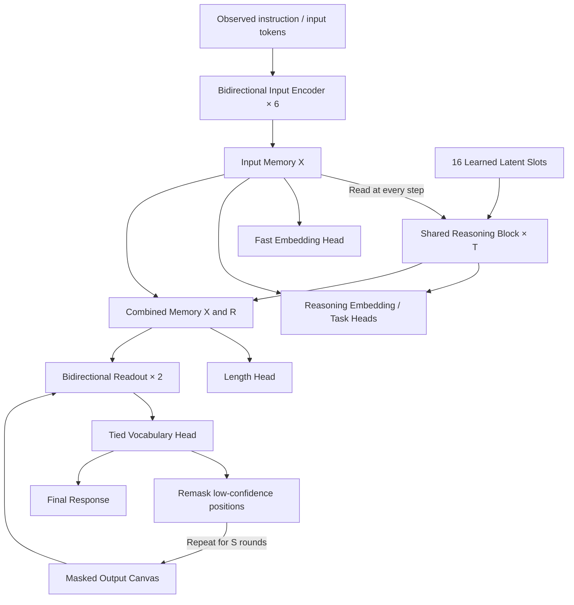

# Nuri v0 Architecture Design

Status: a design draft before implementation. The architecture and validation methods are documented; training and performance validation have not been performed.

> **The user-confirmed decisions in §14 take precedence.** If the body conflicts with §14, follow §14 and record the conflict in the open questions in §17. (2026-10-03, Claude: user decisions D-001 through D-008 incorporated.)

## 1. Goals and Scope

Use one model based on a bidirectional encoder to support embeddings, retrieval, classification, and instruction-conditioned natural language generation. The design connects the latent recurrent reasoning in `.dev/idea1.md`, bidirectional generation in `idea2.md`, sparse MoE in `idea3.md`, and modern encoder blocks in `idea4.md`.

The user's hardware and time constraints are an A100 80GB or H100 and approximately one day of training. The GPU count has not been specified, so the initial plan assumes one GPU. The H100's memory capacity and form factor, training data, tokenizer, and language mix remain undecided.

First validate the architecture with a small dense model of approximately 49.3M parameters. This is distinct from attempting to finish a general conversational model through one day of training from scratch. If natural language quality is the priority, choose a separate path that preserves an existing pretrained encoder and adds the core and readout.

Here, the encoder family means that all self-attention is noncausal and there is no autoregressive decoder. Because the model has a separate cross-attention readout, its topology is not a strict single-stack BERT topology. The precise description is **a bidirectional encoder backbone + a recurrent latent core + a bidirectional masked readout**. Future controls also include a simpler architecture that processes the prompt and masked output together in one encoder stack.

## 2. Overall Architecture



`T_reason` is the number of latent state updates; `S_refine` is the number of output token refinement rounds. They are separate axes of computation. Both default to 4. During generation, `X` and the final `R` are not recomputed. Feeding an output draft back into the core is reserved for a separate follow-up experiment.

## 3. Reference Size

| Item | v0 Reference | Description |
|---|---:|---|
| Hidden dimension `D` | 512 | Reference architecture trained from scratch |
| Attention heads `H` | 8 | MHA; head dimension 64 |
| SwiGLU intermediate dimension `F` | 1,408 | Two gated projections plus a down projection |
| Input layers `L` | 6 | Separate weights for each layer |
| Reasoning blocks | 1 | The entire block is shared across T steps |
| Reasoning slots `K` | 16 | A distinct learned initial value for each slot |
| Training depth `T` | 4 | Start with a fixed depth |
| Readout layers `J` | 2 | Separate layer weights, shared across S rounds |
| Output refinement rounds `S` | 4 | Also compare 8 during evaluation |
| Reference vocabulary `V` | 32,768 | Adjust after selecting the actual tokenizer |
| Initial input limit `N` | 512 | Longer inputs require a separate extension experiment |
| Initial response limit `M` | 64 | Includes EOS; record the fraction of examples that exceed this limit |
| Embedding dimension | 256 | Distinguish fast and reasoning modes |
| Precision | BF16 candidate | Verify support on the actual GPU and backend |

A vocabulary of 32,768 does not mean that a tokenizer has already been selected. Decide after checking the Korean/English mix and whether an existing checkpoint will be reused. When reusing a pretrained model, preserve its vocabulary, hidden size, normalization, FFN, and positional encoding scheme; the parameter counts in this table do not apply unchanged.

## 4. Input Encoder and Memory

The inputs are `tokens [B,N]` and a padding mask `valid [B,N]`. Instructions, observed context, and previous dialogue may be included in the input. Do not put the entire current target response into input memory.

Each input block follows this order:

```text
h → RMSNorm → Q/K/V → RoPE(Q,K) → Bidirectional MHA → residual
  → RMSNorm → SwiGLU → residual
```

Linear projections are bias-free by default. After the final RMSNorm, the encoder produces `X = E_phi(tokens) [B,N,D]`. All input attention is global in v0 to simplify implementation and comparison.

For long-input experiments, add a mixture of bidirectional local and global attention. For example, `G-L-L-G-L-G` across six layers is a candidate Nuri schedule. The final global layer tests the value of integrating information before pooling and memory reading. Specify the local window as `abs(i-j) <= 64`, meaning at most 129 keys at interior positions, rather than the ambiguous `window=128`. Do not assume a speed improvement at sequence length 512. [ModernBERT](https://arxiv.org/abs/2412.13663) is a prior example combining RoPE, GLU, local/global attention, and unpadding. Its global-layer cadence is separate from Nuri's candidate schedule.

Read-only `X` means that its value stays unchanged during reasoning and output refinement. **It does not mean `detach()` or freezing the encoder.** Training is end-to-end by default, with gradients reaching the encoder through every recurrence.

## 5. Recurrent Latent Reasoning Core

The initial state is `R0 = learned_slots [K,D]`, expanded across the batch to `[B,K,D]`. An optional mode/task embedding may be added when needed. This option defaults to OFF in v0.

Compute the K/V projections of the normalized input memory `X` once within a forward pass.

```text
K_X = W_k X, V_X = W_v X

A_t     = R_t + g_cross * CrossAttention(RMSNorm(R_t), K_X, V_X)
B_t     = A_t + g_self  * SelfAttention(RMSNorm(A_t))
R_(t+1) = B_t + g_ffn   * SwiGLU(RMSNorm(B_t))
```

The attention terms include the output projection. Cross-attention excludes input padding, while latent self-attention is bidirectional across all slots. Tensor shapes are:

| Tensor | Shape |
|---|---|
| Latent query | `[B,H,K,64]` |
| Input key/value | `[B,H,N,64]` |
| Cross-attention scores | `[B,H,K,N]` |
| Latent self-attention scores | `[B,H,K,K]` |
| Recurrent state | `[B,K,D]` |

Share all core weights, including normalization, attention, FFN, and gates, across all T steps. Preserve the gradient graph when reusing K/V. Do not reuse a cache after an optimizer update or for a different input.

Each of the three residual branches has a shared sigmoid scalar gate; an initial value of 0.1 is a candidate. This is a stabilization experiment and does not guarantee convergence or depth extrapolation. Keep a `gate=1` comparison. Pass the raw recurrent state to the next step and apply `R_final = RMSNorm(R_T)` only for the final readout.

Input tokens use RoPE, but latent slots have no sentence positions, so slot RoPE defaults to OFF. Likewise, do not rotate slot indices and input token indices in a shared coordinate system for `R→X` cross-attention. Distinct learned initial values give the slots their identities. If order-retrieval tasks reveal problems, test source-key positional features separately.

Step embeddings default to OFF. After training at fixed T=4, evaluate T=1/2/4/8/16 without assuming that performance improves outside the training depth range. Training with random depth `{2,4,8}` is a separate variant. Weight sharing and latent recurrence draw on [Universal Transformers](https://arxiv.org/abs/1807.03819), [Perceiver](https://arxiv.org/abs/2103.03206), and [research on recurrent depth](https://arxiv.org/abs/2502.05171); the reasoning ability of this combination remains a hypothesis to test.

## 6. Embedding, Retrieval, and Classification Paths

Use `u = masked_mean(X)`, which averages only valid input positions, and `r = mean(R_final)`.

```text
z_fast   = L2Normalize(P(u))
z_reason = L2Normalize(P(u + W_r r))
```

`P: D→256` and `W_r: D→D`. Fast mode skips the core. Reasoning mode allows T to be selected. Sharing P does not guarantee that both modes align in the same retrieval space. Use the same mode for queries and documents in the default retrieval setup. Evaluate fast documents with reasoning queries only after training cross-mode contrastive alignment.

Distinguish general-purpose classification heads from heads used to validate the architecture. General classification and reranking may read `concat(u,r)`. A multi-hop architecture-validation head reads only `mean(R_final)` to block the X→head bypass. This restriction alone is not evidence of multi-step reasoning.

Embeddings require a separate contrastive objective. Use sentence or query/document positive pairs and valid negatives. Manage duplicates and false negatives within each batch. Supervised pairs may be used first. Unsupervised experiments following [SimCSE](https://arxiv.org/abs/2104.08821) require independent dropout views. Do not keep the reference block's dropout=0 setting and contrast two identical views.

The token-level MLM head reads X directly through the tied vocabulary projection. MLM is useful for training the backbone, but it bypasses the reasoning core; this loss alone does not establish that the core has been trained.

## 7. Bidirectional Natural Language Generation

The readout processes the output canvas `C_s [B,L_out,D]`. Its memory is the fixed `[X; R_final] [B,N+K,D]`. Each layer follows this order:

```text
C → RMSNorm → Bidirectional Self-Attention + output RoPE → residual
  → RMSNorm → Cross-Attention to [X; R_final]             → residual
  → RMSNorm → SwiGLU                                    → residual
```

The two readout layers have separate weights, shared across refinement rounds. Block weights are not shared between the input encoder, reasoning core, and readout. The token embedding and output vocabulary weights are tied.

Memory cross-attention does not use RoPE by default. Canvas positions belong to the output's internal coordinate system and are not treated as input positions. Project the memory K/V of X and R separately for each readout layer, then reuse those projections across the S rounds of the same generation request. Recompute canvas hidden states and self-attention K/V at every round.

### Information Access Contract

| Query | Accessible keys/values |
|---|---|
| Input encoder token | Valid input tokens from the same sample |
| Reasoning slot | X and latent slots from the same sample |
| Output canvas position | Valid positions in the current corrupted canvas, X, and R |
| X / R | No access to the canvas currently being generated |

When packing, block attention across sample/document boundaries. At response positions included in the loss, replace the original target embedding with an actual MASK embedding; do not leave the target embedding in the input. Response positions left visible after corruption are permitted conditioning context. Do not add the current target response as teacher memory.

### Length and EOS

`LengthHead(concat(u,r))` predicts a distribution over lengths `1..64`, including EOS. During inference, choose the canvas length using `L_hat = argmax`. Represent an empty answer as EOS alone, with length 1.

Training uses a canvas of the gold length. Consequently, the target length is indirectly supplied through the canvas shape, creating a training/inference mismatch. Default evaluation uses predicted length; report oracle-length results separately as an upper-bound diagnostic for the refiner. Record the fraction of examples longer than 64, and do not silently truncate them into incorrect training targets.

Do not stop generation early because an intermediate round predicts EOS. After the final round, truncate at the first EOS. Track missing EOS, premature EOS, and length prediction errors separately. If length errors are the main bottleneck, compare a fixed canvas with an EOS-tail objective.

### Training Objective and Output Refinement

The first generation objective is **conditional masked denoising**. Do not label it diffusion in advance. Mask the entire response with probability 10%; otherwise, sample the mask ratio from `[0.15,0.95]`. Corrupt response positions including EOS. Mask at least one position.

```text
L_gen = sum(CE(logits_i, target_i), i in masked_positions) / masked_count
L_len = CE(length_distribution, gold_length)
```

Each training sample uses one corruption and one readout forward pass. Do not unroll all S=4 rounds in the training graph. Computing vocabulary logits only at masked positions can reduce training cost. In this reference objective, unmasked positions serve as context and receive no CE loss.

Start inference with the following heuristic based on [Mask-Predict](https://aclanthology.org/D19-1633/):

1. Initialize every position at the predicted length with MASK.
2. For round `s=1..S`, predict the current MASK positions in parallel.
3. Store the probability from each position's most recent masked prediction.
4. Unless this is the final round, remask the `ceil(L_out*(S-s)/S)` positions with the lowest stored confidence. Previously filled positions are eligible.
5. After the final fill, apply the EOS rule and return the response.

Do not obtain a new confidence from the softmax of a visible token that has seen its own embedding. A retained token keeps the confidence from its most recent masked prediction. Training corruption and this iterative schedule do not follow the same distribution, so measure performance at each refinement round. Initial sampling is greedy; stochastic sampling is a follow-up comparison.

This method is not the same algorithm as absorbing masked diffusion. A diffusion variant following [LLaDA](https://arxiv.org/abs/2502.09992) must define the forward corruption process, timestep weighting, and reverse transition together. Do not mix parts of a diffusion loss with arbitrary remasking and treat the result as the same model without validation.

## 8. Training Paths

### A. A Scratch Pilot for the New Architecture — v0 Reference

Validate the architecture in an approximately 49.3M model using a mixture of backbone MLM, supervised contrastive pairs, short instruction responses, and structured reasoning tasks. Distinguish general language ability from the effect of reasoning. Synthetic tasks include relation composition, bounded arithmetic, and graph reachability, with splits by template, entity, or graph to reduce memorization.

Candidate batch proportions are text MLM 30%, embedding pairs 30%, short instruction denoising 25%, and reasoning tasks 15%. These are unvalidated initial settings. Process each kind in a separate batch and activate only objectives with valid labels. Do not manufacture arbitrary targets for every head and add their losses to the same sample.

Because multiple objectives update the same backbone, record validation results and loss/gradient magnitudes for each task. Normalize losses over valid positions or valid pairs. The initial weight of `L_len`, 0.1, is adjustable; other task losses start with weight 1 within each task's batch. Interpret global task weighting together with the batch sampling proportions.

V0 does not use supervision with the same final target at intermediate steps, a loss enforcing monotonically increasing confidence, a loss forcing state changes, or a loss forcing latent diversity. This avoids confusing a valid fixed point with collapse.

### B. Reusing a Pretrained Encoder — Prioritizing Language Quality

Select a checkpoint with suitable languages, license, and tokenizer, preserve the existing E architecture, and attach new reasoning, readout, and task heads. Replacing its LayerNorm with RMSNorm or changing its FFN is not straightforward reuse of the existing checkpoint. Since D and V change, recalculate parameter counts and computational cost.

One strategy to test is a brief backbone freeze/warmup followed by joint training with a lower backbone learning rate. Freezing is a separate training strategy, not part of the read-only memory definition. Having an existing encoder does not, by itself, give the new masked generator conversational ability.

Do not attempt to complete both A and B within one day. The user's goal is to validate the new architecture, so A is the current reference path. Reconsider whether B should take priority once the data and checkpoint have been selected.

## 9. MoE and Experimental Features

Enabling every feature at once makes it difficult to identify causes of failure or measure effects. Incorporate the user's ideas either in the baseline architecture or as independent feature variants.

| Feature | Default | Application / experiment contract |
|---|---|---|
| Sparse MoE | OFF | Start by replacing FFNs in input layers 3 and 6; candidate: 4 experts, top-2 |
| Recurrent core MoE | OFF | After verifying the dense core's effect; route BK tokens at each step and record loads per step |
| QK normalization | OFF | After head projections and before RoPE; specify the RMS form and scale, then compare A/B |
| Local/global attention | OFF | Mix attention types only in the input for long sequences; keep full attention for latent K=16 |
| GQA | OFF | Compare reductions in fixed-memory K/V storage and projection cost against quality |
| MLA | OFF | Test the benefits and costs of the latent projection bottleneck itself |
| Adaptive halting | OFF | Requires minimum/maximum T, benefit/correctness supervision, a compute penalty, and calibration |
| Random reasoning depth | OFF | Separate `{2,4,8}` training variant |
| Intermediate supervision | OFF | Add selectively when genuine intermediate-state labels exist |
| Draft→reasoning feedback | OFF | Extension that updates R at every output round; recalculate caching behavior and compute |

The MoE router uses token-level softmax to select top-k experts. Normalize the selected expert weights and combine their SwiGLU outputs. Use dropless routing for the first single-GPU experiment to avoid silently discarding overflow tokens. Calculate router values in FP32, include load-balancing auxiliary loss and z-loss, log expert token counts, and adjust weights after examining their scales. Explicitly document any capacity or token-dropping policy introduced later. [Switch Transformers](https://arxiv.org/abs/2101.03961) provides background on sparse routing and stabilization; its architecture is not identical to Nuri's top-2 configuration.

Replacing two input-layer FFNs with four F=1408 experts and top-2 routing adds approximately 12.98M FFN parameters over the dense baseline. However, both selected experts use F=1408, so the FFN computation for those tokens is approximately twice that of one dense FFN. Do not report equal compute relative to dense merely because the expert pool is sparse. Report active parameters, total parameters, and router/dispatch cost separately. Include a separate compute-matched MoE comparison with narrower FFNs.

### Additional Experimental Ideas

1. **Reasoning-conditioned Matryoshka embeddings.** Apply contrastive loss to the first 64/128/256 dimensions of the 256-dimensional representation. This experiment combines [Matryoshka Representation Learning](https://arxiv.org/abs/2205.13147) with the reasoning path. It allows vector storage to be adjusted but does not automatically reduce backbone computation.
2. **Branched hypothesis slots.** Divide K=16 into four groups, use latent self-attention within each group during early steps, and combine all groups at the final step. Each group reads the same X. Do not assume that groups learn distinct hypotheses without explicit candidate labels or a critic. Compare compute and performance against dense K=16.
3. **A learned step selector.** Use actual task outcomes at multiple T values to predict the expected benefit of further computation. High confidence alone does not establish correctness or justify stopping. Include the selector's errors and runtime cost in evaluation.

## 10. Parameters and Compute

The following counts cover linear matrices and embeddings at V=32768, D=512, and F=1408. Add the small normalization, gate, and length/classification head terms separately.

| Component | Calculation | Parameters |
|---|---|---:|
| Shared token/vocabulary embedding | VD | 16,777,216 |
| Six input encoder layers | 6(4D²+3DF) | 19,267,584 |
| Shared reasoning block | 8D²+3DF | 4,259,840 |
| Learned latent slots | KD | 8,192 |
| Two readout layers | 2(8D²+3DF) | 8,519,680 |
| Embedding P + reasoning W_r | 256D+D² | 393,216 |
| Total, excluding small heads | | 49,225,728 |

The length head `2D→64` adds 65,536 weights. Including biases, RMSNorm, and task heads gives approximately 49.3M parameters. Increasing T or S does not add shared weights, but it increases activations, compute, and latency.

Estimated inference matrix-multiplication FLOPs for one sample with N=512, K=16, M=64, T=4, and S=4 are below. Count 1 MAC as 2 FLOPs and exclude softmax, normalization, activations, sampling, and kernel overhead. The estimate includes full vocabulary projection at all canvas positions and precomputation of the fixed memory K/V.

| Component | GFLOPs |
|---|---:|
| Input encoder | 22.951 |
| Reasoning, including cached source K/V | 1.084 |
| Generation: readout + vocabulary + memory K/V | 14.143 |
| Total | 38.179 |

At the same N/M, T=8 adds approximately 0.547G, while S=8 adds approximately 13.036G. Increasing input length to N=1024 and output length to M=128 with S=8 gives approximately 110.774G. A small latent reasoning loop therefore does not establish that the complete generation path is inexpensive.

Training processes one corruption, so do not apply the inference S=4 multiplier directly. Measure actual training throughput and peak memory, including backward passes, optimizer work, logits for active losses, contrastive views, and padding waste. Global input attention still has complexity `O(LN²D)`; do not claim that the whole model is linear in N.

## 11. One-Day Training Plan

This is a provisional allocation for a day when the data and runtime are ready. Preparation delays reduce actual training time.

| Time Budget | Work | Output |
|---|---|---|
| 2 hours | Check leakage/masks/gradients; benchmark the GPU; overfit a small batch | Backend, batch size, peak memory, and throughput |
| 4 hours | Short T=1 and T=4 pilots, 2 hours each | Same initialization and data splits; comparison by GPU time |
| 15 hours | Main training of the selected dense variant | Main checkpoint and task-specific curves |
| 2 hours | Generation/embedding/reasoning evaluation and intervention ablations | Evaluation table for a fixed checkpoint |
| 1 hour | Buffer | Retries or additional evaluation |

Pilots matched by GPU time do not necessarily use exactly the same FLOPs. Also record training tokens and measured FLOPs. Do not compare the main checkpoint with pilots trained for different amounts of time and claim architectural superiority.

Determine the token budget from measured throughput using `processed_tokens/sec × actual training seconds`. Distinguish processed input/output tokens, masked supervised tokens, unique corpus tokens, and repetitions. Theoretical FLOPs alone do not determine the number of tokens or batch size achievable on an A100/H100 within one day.

Use PyTorch SDPA as the first backend candidate and benchmark the fused backends supported by the actual GPU. Add FlashAttention, unpadding, packing, checkpointing, and compilation according to the runtime environment. An API name or dense attention mask does not establish that local attention runs through a fast sparse kernel. The GPU runtime remains undecided; training feasibility has not been verified in the current Windows workspace.

## 12. Success Criteria and Ablations

The main questions are whether latent recurrence contributes to task performance and whether both uses remain effective within one backbone.

| Comparison | What It Tests |
|---|---|
| Independently trained T=1 vs T=4 | Contribution of recurrence; distinguish equal-token and equal-compute comparisons |
| T=1/2/4/8/16 on the same checkpoint | Effects of inference depth; mark undertrained and extrapolation ranges |
| X-only / R-only / X+R generation | Contribution of each readout memory path |
| R=0 / R shuffled across samples | Core bypass and use of conditioning information |
| K=1/16/32 | Effect of working-memory capacity |
| Shared / unshared weights | Parameter budget and effect of weight sharing |
| One initial cross-read / cross-read at every step | Effect of repeated source reading |
| Fast / reasoning embeddings | Quality, runtime, and alignment of embedding spaces |
| Predicted / oracle length | Separate length prediction errors from denoising errors |
| S=1/2/4/8 | Contribution and cost of output refinement |
| Plain encoder / single masked-canvas encoder | Controls without a latent core |
| Dense / MoE | Total and active parameters, measured runtime, and routing stability |

Prioritize T curves, R interventions, S curves, predicted/oracle length, and fast/reasoning evaluation during the first day. Larger ablations requiring independent retraining and multiple seeds belong to a follow-up budget. Treat results from small pilots as provisional.

Use Recall@k and MRR for retrieval; accuracy/F1 for classification; exact match and generalization across length/difficulty for synthetic reasoning; and exact match, format compliance, and EOS errors on short generation tasks. Include human-readable samples of natural language responses. Report the data split, training examples/tokens, input/output lengths, T/S, parameter count, measured latency, and peak memory with every result.

State norms, step update norms, slot cosine similarity/effective rank, attention entropy, and expert load are diagnostic metrics. `R_(t+1)≈R_t` alone does not establish collapse, and a changing state does not prove reasoning. Increasing confidence in an answer alone does not establish improved accuracy.

## 13. Boundaries for the Next Implementation

Implementation units are `InputEncoder`, `RecurrentReasoningCore`, `BidirectionalReadout`, `EmbeddingHead`, `TaskHead`, `LengthHead`, `CorruptionSampler`, `RefinementSampler`, and `FFNFactory(dense/moe)`. Separate the model forward pass from the external sampling loop, and limit cache lifetime to one forward pass or generation request.

Before training, verify that gradients reach the source encoder, masked targets are absent from the input, attention does not cross packing boundaries, and padding is excluded from pooling and attention. Also verify numerical equivalence during evaluation with and without caching.

The architecture declaration is in [nuri_v0.design.json](../configs/nuri_v0.design.json), and the agent review record is in [design_review.md](design_review.md). The JSON records design choices; it is not yet an executable trainer configuration or an implementation API.
